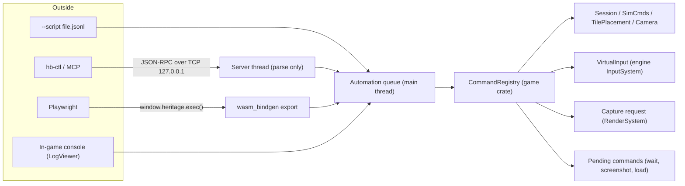

# Agent automation and in-game screenshots

**Status (2026-10-15): Complete.** Approved 2026-10-11. Phase 0 was merged with PR #1. Phases 1–7 are done on the `claude` branch, to be merged into `main` in one PR:
- screenshots;
- the command registry, with script mode and the in-game console;
- the live control server and `hb-ctl`;
- the MCP server and its agent skill;
- simulated input and UI automation;
- the web bridge and CI scenarios;
- record and replay, with image assertions.

Every task is ticked and every open decision is answered. A few checks need a person or CI; see [Remaining checks](#remaining-checks). See [Handoff](#handoff-2026-10-14) for the move to a local machine.

This plan lets AI agents launch the game, drive it, inspect it and debug it. It also adds framebuffer screenshots, which ship to players as well. It was researched against commit `9f26ef8` on the `claude` branch. File and line references point at that commit, so re-check them before relying on them.

## Remaining checks

Everything below is built, and was tested as far as possible without a person at the keyboard or a CI run:
- **Phase 4:** a real Claude Code session using the project's `.mcp.json`. A scripted MCP client was checked; Claude Code asks for approval the first time it sees the project's servers.
- **Phase 5:** real mouse movement has no effect while input capture is on, and Shift+Esc takes the input back. No real input events could be sent on the test machine.
- **Phase 6:** the CI workflow, including the new scenario and record-and-replay steps. It runs once the branch is pushed.
- **Phase 7:** recording real mouse and keyboard input and replaying it, and Shift+Esc during a replay. To check: `cargo run -p HeritageBuilder --release -- --record out/me.rec.jsonl`, play and quit, then run with `--replay out/me.rec.jsonl`. It should log "Replay matched" and exit 0.
- **From the handoff:** the console's [`] key on non-US keyboard layouts.

## How to resume this work

- Work through the [phases](#roadmap-and-progress) in order. Each phase is one PR-sized change that is usable on its own.
- Tick the checkboxes as tasks land, and add a short note under the phase (commit, anything that deviated from the plan). This file is the source of truth for progress.
- The [open decisions](#open-decisions) each have a default. Proceed with the default unless the user has decided otherwise, and record the answer here.
- Follow [AGENTS.md](../../AGENTS.md) throughout. In particular:
  - Keep both the desktop and web targets compiling.
  - Run `cargo test --workspace` before pushing.
  - Don't change `GameSession`'s serialized layout. All automation state is runtime-only, so no save-version bump or migration should be needed. If one turns out to be needed, follow the Saves workflow in AGENTS.md.
  - Route world edits through existing wrappers (`TilePlacement`, `SimCmds`, `TileMap` setters), never raw field writes.

### Working agreements

- After finishing a task and pushing, check CI once and report the result. Don't keep polling. (User preference, 2026-10-11.)
- Commit each phase to the `claude` branch as it lands. Open one PR once all remaining phases (1–7) are done. (User request, 2026-10-14.)

### Handoff (2026-10-14)

Work moves from a Claude Code cloud session to a local machine here. (Kept for history: the work finished locally on 2026-10-15. Phase 1's hardware check passed; the console key on non-US layouts is in [Remaining checks](#remaining-checks).)

- **Branch:** `claude`, pushed, last commit `38e0190` ("In-game console: run automation commands from the log viewer"). PR #1 (Phase 0) was merged into `main`. Phase 1 and the console are on `claude` only, not yet in a PR, per the working agreement above.
- **Verified in the cloud session** (Linux, Xvfb, Mesa software rendering): `cargo test --workspace` passes, and the web build compiles with no warnings. The screenshot and console checks are in the Phase 1 and console notes below. Nothing from that session lives outside the repo: its scratch notes are folded into this file.
- **Still to check on real hardware:**
  - Phase 1 done-when: on a HiDPI Mac, a screenshot comes out at framebuffer resolution and matches the screen, on OpenGL and on Wgpu (`"render_api": "Wgpu"` with `"app_api": "Winit"`).
  - Mac keys: F12 needs Fn unless function keys are set as standard keys. GLFW maps the PC-style PrintScreen key to `PrintScreen`; winit reports it as F13, which isn't bound.
  - The console's [`] key on non-US keyboard layouts.
- **Next task:** the rest of Phase 2. Start with script mode (`--script`): it gives every later phase a way to test itself. Then add the remaining commands, using the implementation notes under Phase 2 (they flag the APIs that panic on bad input). Then add the sample scenarios.
- **Local setup:** macOS needs none of the cloud-only packages (`xvfb`, `mesa-vulkan-drivers`, `libxkbcommon-x11-0`, `xdotool`). Run the game directly. For agent-style checks, use `--screenshot-after-frames N --screenshot-out out/x.png` and read the PNG. The web build uses Homebrew `llvm` + `wasi-libc` (see AGENTS.md).

## Goals

- Agents can start the game in a known state, drive it through commands, simulated input and the UI, and observe it through state queries, logs and screenshots.
- Agent runs can be repeated: same seed, same inputs, same result.
- Players get a screenshot hotkey.
- Everything an agent can do goes through one command surface, shared by every transport.

## Summary

Nearly every gameplay mutation already goes through a deferred, name-addressable path: session commands, `SimCmds`, the player's own `TilePlacement::place`, and cheats looked up by string. Game state is serde-serializable from top to bottom. Most of the work is plumbing that turns these into one command surface and connects it to the outside world.

The plan has seven parts:

1. **One command registry** in the game crate. Named commands take JSON parameters and return JSON results. They run on the main thread at one safe point in `GameLoop::update`.
2. **Three ways in, built in this order.** First a `--script` run mode, which works for agents with nothing but bash. Then a localhost JSON-RPC server with a small `hb-ctl` CLI client. Then a `window.heritage` bridge for the web build that Playwright can drive.
3. **Deterministic time.** A fixed frame delta, plus commands that step frames or fast-forward the simulation.
4. **Simulated input** through a virtual override in `InputSystem`. Injected events alone are not enough, because ImGui, the minimap and edge scrolling poll the cursor and button state every frame.
5. **UI automation.** The retained widget layer records each widget's label and screen rect every frame, so an agent can ask for the widget tree and click a button by name.
6. **Framebuffer capture** for both renderers. Players get a PrintScreen hotkey; agents get a `screenshot` command.
7. **Observability:** state queries, a log feed with more than one listener, and frame stats.

## What exists today

| Area | Status | What the code does |
| --- | --- | --- |
| Session commands | Reusable | `GameSessionCmdQueue` already defers quit, reset map, load preset, load save and save (`crates/game/src/session.rs:42`). `GameLoop` exposes thin wrappers for these. |
| World mutation | Reusable | `SimCmds` spawns and despawns tiles, buildings, units and props, with promises you can poll (`crates/game/src/sim/commands.rs:439`). `TilePlacement::place(context, cell, tile_def, subtract_tile_cost, undo_redo)` and `TilePlacement::clear` are the player's own path, including cost and undo (`crates/game/src/menu/mod.rs:520`). `ImmediateModeSimCmds` (`sim/commands.rs:802`) exists for edits outside the sim tick. |
| Lookups | Reusable | `TileSets::for_each_tile_def` and per-category `find_tile_def_by_name` (`tile/sets.rs`), `World::find_*_by_name` and `for_each_*`, `TileMap::find_tile`, and `TileMap::find_exact_cell_for_point` for screen to cell (`tile/mod.rs:1809`). |
| Cheats | Reusable | Already set by string name through `CheatsLookup::try_set_by_name` (`crates/game/src/cheats.rs`). |
| Introspection | Reusable | `GameSession`, buildings, units, props and `GameConfigs` (`config.rs:15`) all derive serde, so any of them can be returned as JSON without new reflection code. |
| Headless sim | Proven | The integration test harness runs the simulation without a window (`crates/game/tests/test_utils/mod.rs`). `--smoke-test-saves` is a precedent for a scripted run mode (`game_loop.rs:64`). |
| Crash reporting | Partial | On desktop, a panic hook logs the message and a backtrace (`crates/engine/src/platform/desktop/crash_report.rs:61`). The web build uses `console_error_panic_hook` (`platform/web/crash_report.rs`). Nothing is written to a file or sent to a client. |
| Audio without a device | OK | Kira init failure logs an error and returns `None` instead of panicking (`sound/kira/mod.rs:63`), so headless CI should not be blocked by audio. |
| Event injection | Partial | `Application::push_event` exists for the web runner (`app/mod.rs:125`). However, ImGui reads cursor position and button state straight from `InputSystem` every frame (`UiSystem` `update_input`, `ui/mod.rs:445`), and so do the minimap (`tile/minimap.rs:718`, `731`) and camera edge scrolling. The GLFW backend reads the cursor from the OS window (`app/glfw/input.rs:23`). Pushing events alone cannot drive the UI. |
| Frame timing | Gap | `FrameClock` uses wall-clock time (`crates/common/src/time.rs:29`). How many sim ticks run depends on frame rate, so two runs of the same script can diverge. |
| Determinism | Gap | `sim/resources.rs` stores `employers` (line 171) and `employee_households` (line 353) in std `HashMap`s with random seeding, and `for_each_employer` (line 200) iterates them with early exit. See [Determinism audit](#determinism-audit). |
| Screenshots | Missing | No readback path. OpenGL draws UI onto the backbuffer after the scene blit (`render/opengl/mod.rs:216`, `222`). Wgpu creates its surface with `RENDER_ATTACHMENT` only (`render/wgpu/mod.rs:198`, `runner/web.rs:327`), and the offscreen target lacks `COPY_SRC` (`render/wgpu/target.rs:33`). |
| Logs | Partial | Logging uses channels, but `log::set_listener` allows one listener, set once (`log/mod.rs:109`), and the in-game LogViewer takes it (`debug/log_viewer.rs:171`). |
| Player notifications | Missing | There is no player-facing toast. `debug/popups.rs` is dev-only. The engine's `ui::overlay` helper (`ui/mod.rs:1093`) is a good base for a small timed message. |
| CLI | Gap | The only argument is `--smoke-test-saves`, read ad hoc with `std::env::args`. |

## Architecture

Every transport produces the same request: a method name, JSON parameters and a reply target. Requests go into one queue. The game drains that queue on the main thread, so nothing violates the `SingleThreadStatic` rule. Commands that finish in a later frame stay parked until they complete.



### Where the code lives

- `crates/engine/src/automation/` (new): the transport layer (desktop TCP thread, web export), the request queue and reply targets, `VirtualInput` and the input timeline, and PNG encoding. These are platform concerns, so they belong in the engine; AGENTS.md says `game` must not import platform crates.
- `crates/engine/src/render/capture.rs` (new): the capture API on `RenderSystem`, with one implementation per backend.
- `crates/game/src/automation/` (new): `CommandRegistry`, command handlers grouped by area (`session.rs`, `world.rs`, `ui.rs`, …), and the script runner.
- `crates/tools/hb-ctl/` (new workspace member): the CLI client, and later an MCP server.

### Execution point

Drain the queue in `GameLoop::update` right after `self.session_cmd_queue.execute(...)` (`game_loop.rs:174`) and before input events and `update_simulation`. At that point the world is unlocked, no `SimContext` is live, and the engine frame has started, so ImGui queries are valid.

- World edits go through `TilePlacement` or an `ImmediateModeSimCmds` built from a fresh context. `GameSession` needs small helpers that build a `SimContext` or `GameUiContext` from its private fields (see the `make_ui_widget_context!` macro in `session.rs`), because the borrows must be split inside the session.
- Session-level changes are pushed onto `GameSessionCmdQueue`. That queue runs at the start of the next frame, so the reply waits until it has run.
- Pending commands store IDs, never references, because a session load replaces the world under them.

## Command system

One registry, shared by every transport and by the in-game console (an input field in the debug LogViewer):

```rust
pub type CommandFn = fn(&mut CommandContext, serde_json::Value) -> CommandResult;

pub enum CommandResult {
    Done(serde_json::Value),
    Failed(CommandError),             // code + message, e.g. InvalidParams, NotInGame
    Pending(Box<dyn PendingCommand>), // polled once per frame until it resolves
}

pub struct CommandContext<'a> {
    pub engine: &'a mut Engine,
    pub session: &'a mut GameSession,
    pub session_cmds: &'a mut GameSessionCmdQueue,
    pub configs: &'static GameConfigs,
    pub frame: u64,
}

// A static table is enough; no runtime registration needed.
const COMMANDS: &[CommandDef] = &[
    CommandDef { name: "world.place", desc: "Place a tile def at a cell, as a player would", run: cmd_world_place },
    // ...
];
```

- **Parameters** are typed structs with `#[derive(Deserialize)]`. Bad input becomes a clean `InvalidParams` error instead of a panic. Agents will send malformed input often, and the rest of the codebase prefers `unwrap()`.
- **Discovery.** `help` lists every command with its one-line description and parameter schema. The schema comes from a small hand-written table first, or from the `schemars` crate later. Agents learn the surface from the game itself, so docs can't drift.
- **Pending commands** cover anything that spans frames: `wait.frames`, `wait.sim_seconds`, `wait.until`, `screenshot` (GPU readback), session loads, and input gestures.
- **Same path as the player.** Placement goes through `TilePlacement::place` so cost, undo and validation behave the same as a mouse click. Raw `SimCmds` spawns stay available for test setup.
- **Tile names.** Agents won't know tile categories, so add a name-only lookup that searches every layer and category with `TileSets::for_each_tile_def`, and report ambiguous names as an error listing the matches.
- **Save and load report their result.** `GameSession::save_game` returns `bool` (and `load_save_game` too), but `GameSessionCmdQueue` discards it (see `.claude/rules/known-issues.md`). The `session.save` and `session.load_save` commands must return success or failure.
- **Panics** stay fatal, matching the codebase. Extend the existing crash reporter hook (`platform/desktop/crash_report.rs`) to also write a crash file and notify connected clients. See Phase 3.

## Transports

### Script mode (first)

`HeritageBuilder --script crates/game/tests/scenarios/smoke.jsonl` reads one command per line and runs them in order. Each line waits for the previous one to finish. Results go to stdout as JSON lines. The process exits with status 0 if every command succeeded and every assertion passed, and 1 otherwise. This copies the `--smoke-test-saves` pattern. It needs no networking and works the same in CI and in an agent session. Assertions are ordinary commands, such as `assert.gt` on a query result.

```jsonl
{"method":"session.load_preset","params":{"preset":2}}
{"method":"time.fixed_dt","params":{"dt":0.016667}}
{"method":"world.place","params":{"tile":"house_0","cell":[10,12]}}
{"method":"world.road","params":{"from":[9,10],"to":[9,20]}}
{"method":"wait.sim_seconds","params":{"secs":120}}
{"method":"assert.gt","params":{"query":"world.building_at","args":{"cell":[10,12]},"path":"/population","value":0}}
{"method":"screenshot","params":{"path":"out/smoke.png"}}
```

Tile names, cells and result paths above are illustrative; use real names from the tile sets and the actual JSON shape of query results.

Script result lines are machine-readable output written straight to stdout, not through `engine::log`. Treat this as an exception to the logging rule, like `tools/bundler`, and note it in AGENTS.md.

### Localhost JSON-RPC server (second)

- Enabled with `--automation[=PORT]` (default port 7878). `--automation=0` picks a free port, which lets several instances run side by side.
- Binds `127.0.0.1` only. At startup the game writes the port to `logs/automation.port` and a random per-launch token to `logs/automation.token` (`/logs/` is already git-ignored). A connection must send `{"method":"auth","params":{"token":"..."}}` before anything else, so other local processes can't drive the game by accident.
- Uses newline-delimited JSON-RPC 2.0. A background thread parses each request and forwards it over an `mpsc` channel. Replies come back through a per-connection channel. The thread never touches game state.
- Notifications stream log lines, panics and session changes to subscribed clients.
- `hb-ctl` is a tiny CLI so agents never write socket code:
  - `hb-ctl launch [-- game args]` starts the game with `--automation=0`, waits for `ping`, and prints the port and PID.
  - `hb-ctl call world.place '{"tile":"well","cell":[4,4]}'` prints the result, exiting with status 1 on error.
  - `hb-ctl screenshot out.png [--no-ui]`, `hb-ctl logs [--follow]`, `hb-ctl script FILE`, `hb-ctl quit`.
- Later, `hb-ctl mcp` runs as a stdio MCP server that exposes the same registry as tools (Phase 4).

### Web bridge (third)

Browsers can't open a listening socket. Instead, export `window.heritage.exec(request) → Promise<result>` through `wasm_bindgen`, feeding the same queue. Playwright drives it with `page.evaluate`. Screenshots come back as base64 PNG. Playwright's own page screenshot works as a cross-check.

## Frame and time control

Repeatable runs need control over time. Today one simulated minute is a different number of ticks on a fast machine than on a slow one.

- **`--fixed-dt SECONDS`** and `time.fixed_dt`: `FrameClock` reports a constant delta instead of wall-clock time. This one change makes tick counts depend only on frame count.
- **`time.fast_forward {sim_secs, step?}`**: runs `GameSession::update_simulation` repeatedly in fixed steps within a single frame, skipping rendering, until the target sim time is reached. Default step is 1/60 s to match normal play. Account for `sim.speed()`, and return an error while the sim is paused unless `resume: true` is passed. This is the same simulation-only loop the test harness uses, and it's much faster than waiting on vsync.
- **`frame.hold` / `frame.step {n}`**: freezes simulation and animations between agent commands, while rendering continues so screenshots still work. An agent can screenshot, inspect and act without the world moving underneath it.
- **`--seed N`** overrides `SimConfigs::random_seed`. Apply it right after `GameConfigs::load()`, before the session is created.
- A **frame counter** on `FrameClock`, returned with every reply, so logs, screenshots and commands can be lined up afterward.
- A runtime-only **sim time counter** on `Simulation` (`#[serde(skip)]`) for `wait.sim_seconds`. Skipping it in serde leaves the save layout unchanged.

### Determinism audit

`sim/resources.rs` keeps `HouseholdWorkerPool::employers` (line 171) and `employee_households` (line 353) in `std::collections::HashMap` with the default random hasher. `for_each_employer` (line 200) and `for_each_employer_mut` iterate with early exit, so which employers get visited can change between process runs even with a fixed seed. The same maps are serialized as pairs in iteration order, so save files are not byte-stable either.

Fix: switch both to a deterministic map. `BTreeMap` works if the keys implement `Ord`; otherwise use a `HashMap` with a fixed hasher. Generalize the `serialize_hash_map_as_pairs` helper to match. The serialized form stays a list of pairs, so no save-version bump is needed. Then sweep the rest of the simulation code for std hash containers that are iterated (`grep -rn "HashMap\|HashSet" crates/game/src`). Lookup-only maps, such as those in `building/config.rs`, are fine.

## Simulated input

Pushing events is only half of input. The other half is state that gets polled every frame: ImGui sets `io.mouse_pos` and `mouse_down` from `InputSystem`, camera edge scrolling uses the cursor position from `Engine::begin_frame`, and the minimap polls the left button directly. With the shipped GLFW backend, cursor position comes from the OS window.

- **Virtual state.** Add a `VirtualInput` layer inside the frontend `InputSystem`, above both backends. It holds cursor position, button states, key states and modifiers. When it's active, `cursor_pos()`, `mouse_button_state()` and `key_state()` return virtual values.
- **Synthetic events need their own queue.** The web runner already uses `Application::push_event` for real browser input, so synthetic events can't share it. Add `Application::push_synthetic_event`, merged in `poll_events`, so routing in `Engine::poll_app_events` stays unchanged.
- **Input capture mode.** While an agent drives, real input events are dropped (except `Quit` and `WindowResize`), and cursor confinement stops warping the real cursor (see `confine_cursor_to_window` in `app/winit/mod.rs`; check the GLFW path too). Otherwise the user's real mouse resting near a window edge would scroll the map in the middle of a test. A visible "AUTOMATION" badge, drawn with `ui::overlay`, makes the mode obvious.
- **Frame-spread gestures.** Mouse state is polled once per frame, so a press and release in the same frame is never seen. An engine-level input timeline applies one step per frame at the start of `Engine::begin_frame`, before events are polled and before ImGui reads the state. High-level gestures expand into steps:
  - `input.click`: move, then press on the next frame, then release on the frame after.
  - `input.drag`: interpolates the cursor across frames, which road placement needs.
  - `input.type`: sends characters.

  The command stays pending until its steps are consumed.
- **Coordinate helpers.** `camera.cell_to_screen`, and a `cell` target on `input.click`, so agents can say "click cell (10,12)". The cell is converted with the camera's `WorldToScreenTransform`, and the camera teleports first (`Camera::teleport`) if the cell is off screen.

Coordinates are in window points, which is what `InputSystem` already uses. On HiDPI screens screenshots are in framebuffer pixels, so the `screenshot` reply includes the scale factor between them.

## UI automation

The game's own menus (HUD, dialogs, home menu) are built from retained widgets in `crates/engine/src/ui/widgets.rs` (`UiMenu`, `UiTextButton`, `UiSpriteButton`, `UiSlider`, `UiDropdown`, …). Each has a label and draws as one ImGui item. That makes a widget tree cheap to build.

- **Per-frame widget registry.** Each leaf widget records `{path, kind, label, rect, enabled, hovered}` in its own `draw`, right after its ImGui item call, using `item_rect_min` / `item_rect_size`. `UiMenu` and the group layouts push and pop a path segment around their children; the child draw sites are `widgets.rs:687`, `internal.rs:244` and `internal.rs:337`. The registry is cleared at `UiSystem::begin_frame` and only records while automation is on, so a normal session pays nothing. Duplicate paths get a `#n` suffix.
- **`ui.tree`** returns the registry: every visible widget with a stable path such as `"Main Menu/Load Game"`.
- **`ui.click {path}`** resolves the widget's rect from the latest registry and clicks its center with the input timeline. This is a true end-to-end click, with the same hover, sound and callback behavior as a player's. It fails if the widget is missing or disabled.
- **`ui.set {path, value}`** for sliders, checkboxes, text inputs and dropdowns. Dragging a slider to an exact value with simulated input is fragile, so this writes through the widget's own `on_update_value` callback instead. The callback needs a widget context, so queue the value in `UiSystem` and apply it during that widget's next `draw`.
- **`dialog.open` / `dialog.close` / `dialog.current`** wrap the existing `menu::dialog` functions.

The developer editor menus are immediate-mode ImGui and have no retained layer. For those, agents fall back to coordinates plus screenshots. A small `automation_id` helper in the debug UI could close that gap later if it matters.

## Screenshots

The same mechanism serves players and agents. A capture is requested during a frame and filled in at the end of the backend's `end_frame`, after UI has drawn and before present (`app.present()` runs after `RenderSystem::end_frame`; for GLFW the swap is `app/glfw/mod.rs:117`). The result is RGBA8 pixels with a top-left origin, plus size and scale. It arrives that frame on OpenGL, and a frame or more later on Wgpu.

### OpenGL (desktop default)

In `OpenGlRenderSystem::end_frame`, after `ui_frame_bundle.render()` (`render/opengl/mod.rs:222`), read the back buffer at framebuffer size: bind the default framebuffer for reading, set `GL_PACK_ALIGNMENT` to 1, call `glReadPixels` with `GL_RGBA`/`GL_UNSIGNED_BYTE`, and flip rows (GL's origin is bottom-left). It's synchronous and simple. To avoid a stall in the hotkey path, it can later read into a pixel buffer object and map it on the next frame.

### Wgpu (desktop and web)

- The surface is configured with `RENDER_ATTACHMENT` only, and `COPY_SRC` support on surfaces varies by backend (the web build may fall back to WebGL). The portable approach: on capture frames, run the blit pass and the UI pass a second time into a capture texture with `RENDER_ATTACHMENT | COPY_SRC`. Create that texture in the surface format, so the existing blit and UI pipelines can render into it unchanged. Batches and UI draw commands are already recorded at that point, so the extra passes cost something only on capture frames.
- Copy the texture into a `MAP_READ` buffer with `copy_texture_to_buffer`, padding rows to `wgpu::COPY_BYTES_PER_ROW_ALIGNMENT` (256), then call `map_async`. On desktop, poll the device on the same or next frame. On web, resolve in the map callback, which is why `screenshot` is a pending command.
- Strip row padding, and swap channels when the surface format is BGRA. The code picks a non-sRGB surface format on purpose (`render/wgpu/mod.rs:191`), so bytes pass straight through with no gamma conversion.
- For scene-only captures, add `COPY_SRC` to the offscreen target's usage (`render/wgpu/target.rs:33`) and copy from it.

### Options

- `include_ui` (default true). Setting it to false captures the offscreen scene target, which helps agents check world rendering without menus in the way. The offscreen target is sized `max(viewport, framebuffer)` on both backends.
- `region` (a cell range or screen rect) for crops, and `scale` for downsampled thumbnails, which keep agent context small.
- Output as a file path, or as base64 PNG in the reply. PNG encoding uses the `image` crate, which the engine already depends on.

### As a player feature

- PrintScreen (and F12, since Mac keyboards lack PrintScreen) saves `screenshots/Heritage Builder 2026-10-10 14-03-22.png` next to `saves/`, then shows a short message with the file name. There's no toast widget yet; build a small timed one on `ui::overlay`.
- Handle the key in `GameLoop::handle_app_event`. The engine forwards PrintScreen and F12 even while ImGui has keyboard focus (`screenshot::is_hotkey` in `Engine::poll_app_events`), so a screenshot can be taken with a dialog open. Neither is a text-input key, so typing isn't affected.
- There's no date-time crate in the workspace. To build the file name, either format UTC from `SystemTime` with a small civil-date helper, use `libc::localtime_r` (`libc` is already a desktop dependency of the engine), or add a crate such as `time`.
- Encode and write the PNG on a background thread on desktop, so the hotkey never causes a frame hitch.
- Optional: a Settings toggle for "hide interface in screenshots".
- On web, the PNG downloads through a Blob and an anchor element created by the page. That needs extra `web-sys` features (`Blob`, `BlobPropertyBag`, `Url`, `HtmlAnchorElement`), so it lands in Phase 6.

## State, logs, stats

- **Queries** return serde JSON straight from the game's own types: `world.inspect {kind, id}`, `world.building_at {cell}`, `world.list {kind}`, `tile.at {cell, layer}`, `sim.state` (paused, speed, treasury, date), `world.stats`, and `session.state` (menus mode, map size, current campaign mission). An optional `fields` filter (a list of JSON pointers) keeps replies small.
- **Log fan-out.** Replace the single `OnceLock` listener with a small listener list, so LogViewer, the automation server and the crash report can all listen. Pass records by reference. Listeners must not log, or must be called without holding the list lock, to avoid deadlocks. Give every record a sequence number, and keep a ring buffer of recent records for `logs.tail {since, min_level, channel}` and for crash reports.
- **Stats.** `debug.stats` returns `GameLoopStats` and `RenderStats`: frame time breakdown, draw calls and triangle counts.
- **Save as a snapshot.** `session.save` already gives a complete, diffable state dump. A `session.dump` command can return it inline for small maps.

## Command catalog (v1)

| Group | Methods | What they do | Built on |
| --- | --- | --- | --- |
| Meta | `ping`, `help`, `version`, `quit` | Liveness check, command list with schemas, build info, clean exit | `GameLoop::quit_game` |
| Time | `time.fixed_dt`, `time.fast_forward` | Constant delta; run N sim seconds in one frame | `FrameClock`, `GameSession::update_simulation` |
| Time | `frame.hold`, `frame.step`, `wait.frames`, `wait.sim_seconds`, `wait.until` | Pause, step and sync with the game | Pending commands |
| Session | `session.new_map`, `session.load_preset`, `session.load_save`, `session.save`, `session.quit_to_menu`, `session.state` | Start, load and save games | `GameSessionCmdQueue` |
| Session | `menus.mode` | Switch between HUD and dev editor | `push_toggle_menus_mode` |
| Simulation | `sim.pause`, `sim.resume`, `sim.speed`, `sim.state` | Control and read the sim | `Simulation` API |
| Simulation | `cheats.list`, `cheats.set` | Toggle cheats by name | `CheatsLookup` |
| Simulation | `config.get`, `config.set` | Read and patch configs as JSON | serde on `GameConfigs` |
| World | `world.place`, `world.clear`, `world.road` | Place and remove as a player would | `TilePlacement::place` / `clear`; road segment logic in `menu/mod.rs:418–476` |
| World | `world.spawn_unit`, `world.despawn` | Direct spawning for test setup | `SimCmds` promises |
| World | `world.inspect`, `world.list`, `world.building_at`, `tile.at`, `world.stats` | Read state as JSON | `World::find_*`, serde |
| World | `undo`, `redo` | Exercise undo history | `undo_redo` |
| Camera | `camera.teleport`, `camera.zoom`, `camera.cell_to_screen`, `camera.screen_to_cell` | Frame shots and convert coordinates | `Camera`, `find_exact_cell_for_point` |
| Input | `input.capture`, `input.move`, `input.click`, `input.drag`, `input.key`, `input.type`, `input.scroll` | Simulated mouse and keyboard | `VirtualInput`, synthetic events |
| UI | `ui.tree`, `ui.click`, `ui.set`, `dialog.open`, `dialog.close`, `dialog.current` | Find and operate widgets by name | Widget registry, `menu::dialog` |
| Observe | `screenshot` | Capture the frame to a file or base64 | Render capture |
| Observe | `logs.tail`, `logs.subscribe`, `debug.stats` | Logs and performance | Log fan-out, `GameLoopStats` |
| Assert | `assert.eq`, `assert.ne`, `assert.gt`, `assert.lt`, `assert.exists` | Checks for script mode | Query commands |

Road placement today is driven by the menus' `TilePlacement::update_road_segment` and the private `try_place_road_segment`. `world.road` needs a public function that builds a segment between two cells and places it.

## Roadmap and progress

### Phase 0: Foundations (small)

- [x] Command-line module in the engine. Desktop reads `std::env::args`; web returns defaults for now (URL query parameters can come later). Flags:
  - `--fixed-dt SECONDS`
  - `--seed N`
  - `--window-size WxH`
  - `--map preset:N`
  - `--load-save NAME`
  - `--skip-home-menu`

  Move `--smoke-test-saves` into it.
- [x] Fixed-delta mode on `FrameClock` (`Engine::set_fixed_delta_time`), and a frame counter.
- [x] Log fan-out with multiple listeners, sequence numbers, and a recent-records ring buffer. Update `debug/log_viewer.rs` to the new API.
- [x] Deterministic maps in `sim/resources.rs`, and a sweep of other iterated std hash containers in simulation code.

Done when:
- `cargo test --workspace` passes, and desktop and web build.
- A unit test shows `FrameClock` returns the fixed delta when set.
- A unit test shows two log listeners both receive a record.
- `--smoke-test-saves` still works through the new module.

Notes (2026-10-11):
- **Command line.** `engine::cli` parses `--name`, `--name=value` and `--name value` against option tables: `ENGINE_CLI_OPTIONS`, plus the run loop's through the new `RunLoop::cli_options`. Both runners call `cli::initialize` right after `platform::initialize()`, because the first log line decides where log output goes. Unknown options and missing values exit with status 2 and list the options; `--help` lists them and exits 0. Single-dash launcher arguments (macOS `-psn_...`) are ignored with a warning.
- **Game options** live in `game::launch` (`LaunchOptions`). Also added `--map empty:WxH`.
- **Deviation:** options are applied where they're used (`session::create_initial`, `Simulation::new`, the desktop runner, `Engine::start`), not written into `GameConfigs`. The settings dialog saves the whole configs struct to `configs.json`, which would persist them. The start map applies only to the first session, so "quit to main menu" still shows the home menu. `--load-save` with a save that fails to load exits with status 2.
- **FPS display.** It now uses `FrameClock::real_delta_time()`, so it stays accurate under `--fixed-dt`.
- **Determinism sweep** found more than the plan listed:
  - The worker maps are now `BTreeMap`s, with `Ord` derived on `BuildingKind`, `BuildingKindAndId` and `GenerationalIndex`.
  - `common::hash::SmallSet` uses a fixed-key hasher for its heap storage (house merging iterates it).
  - New maps randomized their cosmetic terrain variations with the unseeded thread RNG. Those variations are saved, so they now use the game seed.
  - Saves keep the same format, so no version bump.
- **Shutdown crash fixed.** Exiting the game segfaulted on Linux/Mesa, so even a successful smoke test exited with status 139. `Engine` dropped its `Application` (window and GL context) before the render system, which then called GL with no context. `app` is now the last field of `Engine`, so it drops last.
- **Verified:**
  - `cargo test --workspace` passes.
  - Desktop and web builds pass (web with wasi-sdk 32, as in CI).
  - `--smoke-test-saves` loads all 11 sample saves and exits 0 under `xvfb-run`.
  - Two runs of `--load-save test_save_2 --fixed-dt 0.016667` (51 worker assignments by then) wrote byte-identical first autosaves, and so did two runs of `--map preset:2 --seed 7 --fixed-dt 0.016667`.
- Found in passing and fixed in a separate commit: the texture atlas cache was never written on a fresh checkout.

### Phase 1: Screenshots (medium)

- [x] `render/capture.rs`: `CaptureRequest { include_ui }` and `CapturedImage { size, scale, pixels }` (RGBA8, top-left origin), plus `RenderSystem::request_capture` and `take_finished_captures`. Backends get the `CaptureQueue` through `end_frame`.
- [x] OpenGL readback (back buffer, plus offscreen target for scene-only).
- [x] Wgpu readback on desktop (capture texture, padded copy, map, swizzle). It should compile for web, but web testing waits for Phase 6.
- [x] PrintScreen / F12 hotkey, `screenshots/` folder, timed message, PNG encoding off the main thread. Add `/screenshots/` and `/out/` to `.gitignore`.
- [x] One-shot mode: `--screenshot-after-frames N --screenshot-out PATH` captures after N frames, writes the PNG, and quits with status 0.

Done when:
- The hotkey writes a PNG that matches the screen, UI included, on OpenGL (the shipped config) and on Wgpu (`engine.render_api = "Wgpu"`), at framebuffer resolution on a HiDPI Mac.
- `include_ui: false` produces a scene-only image.
- `cargo run -p HeritageBuilder -- --skip-home-menu --map preset:1 --fixed-dt 0.016667 --screenshot-after-frames 120 --screenshot-out out/shot.png` writes the image and exits 0.

Notes (2026-10-14):
- **API.** `Engine::request_screenshot(ScreenshotRequest { include_ui, output })` returns an id; poll `Engine::take_screenshot_result(id)`. Output is a file or the PNG bytes in memory. `engine::screenshot` owns encoding, the background writer threads and timestamped file names. The engine drains `RenderSystem::take_finished_captures` itself every frame.
- **Deviation: scene-only on OpenGL** reads the back buffer right after the scene blit, before the UI draws, instead of reading the offscreen target. It comes out at framebuffer size, like a full capture; the offscreen target can be larger.
- **Wgpu** re-encodes the blit and UI passes into a capture texture on capture frames (the surface can't be a copy source). Desktop waits on the device, so the capture is ready that frame. Web will finish it a frame or more later, from the map callback.
- **Hotkey.** PrintScreen fires on release (Windows reports only the release), F12 on press, and Shift leaves the UI out. The engine forwards these keys even while ImGui has keyboard focus. The hotkey is desktop-only until the web download lands in Phase 6. Toasts (`UiSystem::show_toast`) are new, and hidden on capture frames so they never show up in screenshots.
- **File names** use local time from `platform::local_date_time()`: `libc::localtime_r` on desktop, `js_sys::Date` on web. No date crate was added. Names get " (2)", " (3)", ... when taken.
- **Exit codes** (moved up from Phase 2): `Engine::request_exit(code)`, and the desktop runner exits with `Engine::exit_code()` after a clean shutdown. A one-shot run that quits before its PNG is written exits 1. Relative `--screenshot-out` paths are resolved against the directory the game was started from (`cli::path_value`).
- **Verified** under `xvfb-run` on Mesa:
  - OpenGL/GLFW and Wgpu/Winit (Vulkan via lavapipe, BGRA surface) both produce correct images, with and without UI. The two backends differ in 13 pixels scene-only, and in about 0.4% of pixels with UI (text antialiasing).
  - `xdotool` key presses for F12, Shift+F12 and PrintScreen saved files on both app backends, and the toast showed on screen but not in the files.
- **Verified on a HiDPI Mac** (2026-10-15, Apple Silicon, content scale 2). The done-when command with `--window-size 1280x720` ran on OpenGL/GLFW and on Wgpu/Winit (Metal). The Wgpu run used a throwaway `.app` copy with its own `configs.json`, so the repo's config stayed as it is.
  - Both captures are 2560x1440 (framebuffer resolution), show the same frame, and exit 0.
  - `--screenshot-no-ui` on Wgpu leaves the UI out.
  - F12, sent as simulated input (`input.key`), saved a 2560x1440 PNG to `screenshots/` on both backends.

### Phase 2: Command registry and script mode (medium)

- [x] `crates/game/src/automation/`: `CommandRegistry`, `CommandContext`, `CommandResult`, `CommandError`, `PendingCommand`, dispatch at the execution point above.
- [x] Engine-side request queue and reply targets, shaped so Phase 3's channel and Phase 6's web bridge slot in.
- [x] `GameSession` helpers for building a `SimContext` / `GameUiContext`, and `pub(crate)` save/load that report their result. (`with_sim_context` only; the `GameUiContext` helper waits for the dialog commands in Phase 5.)
- [x] Commands: meta, time, session, sim, cheats, config, world, camera, observe (`screenshot`, `logs.tail`, `debug.stats`) and assert.
- [x] `--script FILE`: JSON lines in (blank lines and `#` comments allowed), JSON lines out, stop at the first failure (`--script-continue-on-error` to keep going), exit status 0/1. Autosave off in this mode, as in the smoke test.
- [x] Exit-code plumbing: the desktop runner currently returns `()`. Add a way for the run loop to report an exit code (for example `RunLoop::exit_code()`), and call `std::process::exit` after a clean shutdown. (Done in Phase 1 as `Engine::request_exit(code)`; the desktop runner exits with `Engine::exit_code()`. The `quit` command takes an `exit_code`.)
- [x] Sample scenarios in `crates/game/tests/scenarios/`: `smoke.jsonl` (load, place, fast-forward, assert, screenshot) and `determinism.jsonl`.
- [x] In-game console: an input field in the debug LogViewer (`debug/log_viewer.rs`) that runs registry commands, prints each result into the log view, and keeps a command history (up/down arrows). See Q3.

Console notes (2026-10-14, done ahead of the rest of Phase 2 as one change):
- **Registry core.** `crate::automation`: `CommandDef { name, help, params, run }` tables per area in `automation/commands/`, registered in `COMMAND_GROUPS`. A handler is `fn(&mut CommandContext, Value) -> CommandResult`, where `CommandResult = Result<Outcome, CommandError>` and `Outcome` is `Done(Value)` or `Pending(Box<dyn PendingCommand>)` (`pending(closure)` builds one). `parse_params` deserializes typed params, and `{}` stands in for missing params. `Automation::update` runs at the dispatch point (right after `session_cmd_queue.execute`). It polls pending commands first, then runs new console lines. There's no separate `CommandRegistry` type: the static tables are the registry.
- **Starter commands:**
  - `help`, `ping`, `version`, `quit`
  - `session.state`, `session.list_presets`, `session.load_preset`, `session.list_saves`, `session.load_save`, `session.save`, `session.quit_to_menu`
  - `sim.pause`, `sim.resume`, `sim.speed`, `cheats.list`, `cheats.set`
  - `time.fixed_dt`, `wait.frames`
  - `camera.state`, `camera.teleport`, `camera.zoom`
  - `screenshot`, `console.clear`
  - New supporting APIs: `Simulation::set_speed` / `speed_limits`, `Camera::snap_zoom`, `cli::resolve_launch_path`; `GameSession::save_game` is now `pub(crate)`.
  - Still to do in Phase 2: the world, config, logs, stats, assert and remaining time commands; `save_game` / `load_save_game` returning the error text instead of `bool` (the commands point at the log for now).
- **Console UI.** The text forms (`automation/text.rs`) are `name`, `name key=value ...` (values are JSON, or else plain text), `name {json}` or `{"method": .., "params": {..}}`. Results print under a `[console]` channel without being logged, so they don't count as errors or warnings. Lines typed into the field are queued in the viewer and run at the dispatch point, never inside the draw: the viewer holds its lock for the whole draw, and commands log.
- **Access.** The [`] key opens and closes the viewer in every menus mode. It now draws from `GameLoop::menus_end_frame` instead of the DevEditor menus, with the dev font; the DevEditor "Show Log Viewer Window" checkbox stays in sync with it.
- **Verified** under Xvfb with `xdotool`: typed commands in the HUD mode ran `help`, `sim.speed`, `session.load_preset` (pending, one frame), `session.state`, `screenshot` (pending, wrote the PNG), `camera.teleport` and `cheats.set`. An unknown command printed an error, and the up arrow recalled history. Headless runs flood the view with verbose ambient-sound lines (no audio device); filter them with Filter → Channels.
- [x] AGENTS.md: document `--script`, the scenario format, `help`, and the stdout exception to the logging rule.

Phase 2 completion notes (2026-10-14, local Mac):
- **Request queue.** `engine::automation`: transports queue a `Request { method, params, responder }` through a cloneable `RequestSender`, from any thread; `Engine::take_automation_requests` drains them. A `Responder` answers once, and one dropped unanswered (the game quit) answers `Cancelled`. Every response carries the frame it finished on. The game's `ReplyTo` is `Console`, `Script { line }` or `Remote(Responder)`.
- **Commands** (58 in all; `help` lists them). New in this change: `session.new_map` (a fresh simulation seeded like `--map`, unlike the new-game dialog's reset, which keeps the old one), `session.checksum`, `menus.mode`; `sim.state`; `time.fast_forward`, `wait.sim_seconds`, `wait.until`, `frame.hold`, `frame.step`; `tiles.list`, `world.place|clear|road|spawn_unit|despawn|list|building_at|inspect|stats`, `tile.at`, `undo`, `redo`; `camera.cell_to_screen|screen_to_cell`; `config.get|set`; `logs.tail`, `debug.stats`; `assert.eq|ne|gt|ge|lt|le|exists`.
- **Deviations:**
  - `help` with no arguments lists every command with its parameters (agents need the schemas); the console prints it as text, one line per command.
  - Object ids are strings, `pool:index:generation`, where the pool is `house`, `producer`, `storage`, `service`, `unit` or `prop`. Building lookups need the pool because each archetype has its own index space.
  - `world.place` always pays, as the player does; tests that need money turn on the `ignore_tile_cost` cheat.
  - A script with unreadable or invalid lines exits with status 2 before running anything, like other bad command-line input, and reports each bad line as a JSON line.
  - Logs move to stderr in script mode (`log::redirect_to_stderr`, set in `GameLoop::on_early_init` from the raw arguments).
  - `time.fast_forward` runs at most 600 steps per frame (a count, so runs split the same way every time), and its `sim_secs` includes the frames' own updates while it runs.
- **Found in passing:**
  - The treasury reads zero until the first simulation step after a load (world stats are only recounted on steps), so placement right after a load failed with "can't afford". `World::refresh_stats` recounts without updating; commands call it before placing and reporting.
  - `SpawnPool::try_get` panicked on out-of-range indices; it checks the bounds now.
  - Debug builds took seconds to PNG-encode a screenshot. The workspace now builds the PNG crates at `opt-level = 3` in the dev profile: a full-screen screenshot takes about a second instead of six, and asset loading drops from 2.2 s to 0.4 s.
  - `TileCategory::find_tile_def_by_name` logs an error when the name is missing, so name searches across categories compare names instead.
- **Verified** on macOS (Apple Silicon, HiDPI 2x, OpenGL/GLFW): `smoke.jsonl` exits 0 and its screenshot shows the settlement; a failing assertion exits 1; `quit exit_code=3` exits 3; two `determinism.jsonl` runs with `--seed 7` print the same checksum and write byte-identical saves, and `--seed 8` gives a different one; 20 malformed or out-of-range commands each returned a clean error.

Implementation notes from the Phase 2 code survey (2026-10-14, against `8494da9`). Items marked *(done)* landed with the console change (`38e0190`):
- **Dispatch point** is right after `self.session_cmd_queue.execute(...)` in `GameLoop::update` (game_loop.rs:190 at that commit). `GameLoop` fields are private, so build `CommandContext` there with split borrows. `Engine::request_exit` and the desktop exit code already exist (Phase 1).
- **Contexts.** `GameSession` fields are private and `make_ui_widget_context!` / the `SimContext` macros are module-private. Add closure-scoped helpers in session.rs (`with_sim_context`, `with_ui_context`) built on `Simulation::new_sim_context`. Never store a `SimContext` or `&Tile` in a pending command: loads replace the world.
- **Save/load results.** Both are now `pub(crate)` and called directly at the dispatch point, and save names are validated *(done)*. Still to do: return `Result<(), String>` instead of `bool`, so commands can report the reason.
- **Session commands.** Preset numbers are silently clamped (validate against `preset_maps::preset_tile_maps_list().len()`). `load_preset` doesn't reset the campaign (call `campaign::reset()`). Both are handled by `session.load_preset` *(done)*. Some presets turn cheats on globally. `reset` keeps the `Simulation` (RNG, gold, speed), so `--map` / `load_preset` / `load_save` are the deterministic starts. `menus.mode` must compare before pushing the toggle.
- **World edits.** `TilePlacement::place/clear(&SimContext, ...)` are associated functions; `Failed` drops the error message (add a field). There is no public road-segment placement (factor it out of `try_place_road_segment`). Use `ImmediateModeSimCmds` / `Spawner`, never the sim's deferred queue (`Simulation::update` asserts it's empty). Check `is_cell_within_bounds` before any placement: negative cells and huge road spans assert or allocate.
- **Panics to pre-empt.** `SpawnPool::try_get` / `try_get_mut` index without a bounds check (fix with `spawned.get(index)`). `BuildingKind::archetype_kind()` panics on empty kinds, and `find_building` searches only the first matching archetype. Serializing a `Building` with a pending spawn promise debug-asserts: run its `pre_save` first, or build summaries by hand. `set_fixed_delta_time` debug-asserts dt > 0. Camera commands need a valid map (the home session's camera asserts on an empty map).
- **Missing pieces.** `Simulation::set_speed` and `Camera::snap_zoom` *(done)*. Still missing: a sim-time counter (add a `#[serde(skip)]` f64). `TileDef`, `GameLoopStats`, `RenderStats`, `WorldStats` and `log::Record` aren't `Serialize`; build JSON by hand. `Cell` serializes as `{x, y}`, so accept `[x, y]` too.
- **Configs.** `GameConfigs::get_mut()` exists. `config.set` must patch through a JSON round trip of the whole struct, because `#[serde(default)]` resets missing fields. Keep the originals, and write them back around the settings dialog's `GameConfigs::save()` in `menu/dialog/settings/mod.rs`, so runtime patches never reach configs.json.
- **Console** *(done)*. The LogViewer holds its mutex for the whole draw, so the input field only queues lines; the dispatcher drains them and prints results without logging. The viewer now draws from the GameLoop in every menus mode.
- **Script output.** Logs go to stdout, so in script mode switch logging to stderr before the first log line. `RunLoop::on_early_init` runs before platform init and can check `std::env::args()` for `--script`.

Done when:
- `cargo run -p HeritageBuilder -- --script crates/game/tests/scenarios/smoke.jsonl` exits 0 and prints JSON lines; a failing assertion exits 1.
- `help` lists every command with its description and parameters.
- Malformed parameters return `InvalidParams` and never panic.
- Running `determinism.jsonl` twice with the same `--seed` and `--fixed-dt` produces byte-identical saves.
- The registry compiles on web (script mode itself is desktop-only).

### Phase 3: Live control server (medium)

- [x] `crates/engine/src/automation/server.rs` (desktop only): loopback listener, per-connection reader and writer threads, newline-delimited JSON-RPC 2.0, `auth` handshake, port and token files in `logs/`. If an explicitly requested port is taken, fail fast with a clear message.
- [x] Main thread drains the channel into the Phase 2 dispatcher. Pending replies keep their connection's reply sender.
- [x] Notifications: `logs.subscribe` (through a log listener), `panic`, session changes.
- [x] Extend the crash reporter hook: write `logs/crash-<timestamp>.txt` with the message, backtrace, recent log records and frame number, and send a `panic` notification before exit.
- [x] `crates/tools/hb-ctl` (add to workspace members): `launch`, `call`, `screenshot`, `logs`, `script`, `quit`. Uses std networking and `serde_json` only.
- [x] AGENTS.md: how to launch and drive a live instance.

Notes (2026-10-14, local Mac):
- **Discovery files.** Deviation: instead of `logs/automation.port` and `logs/automation.token`, one JSON file `{pid, port, token}`, written twice: `logs/automation.json` for the latest instance, and `logs/automation-<pid>.json`, which `hb-ctl launch` waits for so several instances can run side by side. Both are mode 0600 and removed on exit, and also when the main thread panics (the process then ends without dropping the server).
- **Ports.** `--automation=PORT` that's taken exits with status 2 and suggests `=0`. Plain `--automation` falls back to a free port with a warning when 7878 is taken. The CLI parser gained optional values: a bracketed placeholder (`[PORT]`) means the value only comes from the `--name=value` form.
- **Server.** Reader threads poll a stop flag every 50 ms; writer threads own the socket writes, so a client that stops reading never blocks the main thread. On shutdown the server waits up to a second for queued writes, so the response to `quit` gets out. Requests without an id run without a response (JSON-RPC notifications); batches are rejected.
- **Crash reports.** The desktop panic hook is now always installed. It writes the crash file, notifies listeners (the server sends `panic` straight to each socket, since the process may end before the writer threads run), then logs the panic (bundles) or hands it to Rust's default hook (terminal runs). `log::try_recent_records` never waits on the logger's lock inside the hook. `debug.panic` crashes on purpose.
- **Session events.** `session::generation()` changes when a session is created, loaded or reset to a new map; the GameLoop sends `session.changed` after the dispatch point.
- **Verified** on macOS: `hb-ctl launch` (about 9 s in debug), `call`, `commands`, `screenshot --no-ui`, `logs`, `logs --follow` (log records, `session.changed`, `panic`), `script smoke.jsonl` and `quit`; requests before `auth` and with a wrong token are refused; JSON-RPC errors (parse, batch, unknown method, invalid params); `debug.panic` wrote a crash file, the follower got `panic`, and the pending call got `Cancelled`; a taken explicit port exits 2; the web build still compiles.

Done when:
- `hb-ctl launch`, then `hb-ctl call ping`, works. `hb-ctl screenshot` writes a PNG, and `hb-ctl logs --follow` streams.
- Requests before `auth` are rejected, and the server binds loopback only.
- A forced panic produces a crash file and a `panic` notification.
- The web build is unaffected.

### Phase 4: MCP server and agent skill (small to medium)

Moved ahead of simulated input and UI automation (Q2). It needs only Phase 3's server and Phase 2's `help`.

- [x] `hb-ctl mcp`: stdio MCP server with `initialize`, `tools/list` and `tools/call`. It maps each registry command to a tool using the schemas from `help`, and `screenshot` returns image content. Add a project `.mcp.json` so Claude Code picks it up.
- [x] `.claude/skills/drive-game/SKILL.md`: launching, driving, screenshots, and common debugging recipes. List it in AGENTS.md.

Done when: a local Claude Code session lists the game's tools over MCP, and can take a screenshot and place a building through them.

Notes (2026-10-14, local Mac):
- **Tools.** Three always: `game_launch` (builds and starts the game, like `hb-ctl launch`), `game_connect` and `game_call` (any command by name, for clients that don't refresh their list). Once a game is connected, one tool per command (dots become underscores, since MCP tool names can't hold dots), and the server sends `notifications/tools/list_changed`. A game that `game_launch` started gets `quit` when the client disconnects.
- **Screenshots.** The `screenshot` tool saves to a temporary file, returns the PNG as image content, and deletes the file unless a `path` was given. It defaults to `scale: "points"`, which the screenshot command gained here (`ScreenshotScale::Points` / `Factor` in the engine, scaled on the writer thread): on a 2x screen the image is 1440x792 instead of 2880x1584, about 300 KB, and its pixels are window points, the units input coordinates use.
- **Crashes.** A failed call includes any `panic` notification the game sent: the message, location and crash file.
- **Found in passing:** the HUD showed 0 gold until the first simulation step after a load. Sessions now recount the world stats when created or loaded; the determinism checksum is unchanged.
- **Verified** with a scripted MCP client over stdio (`initialize`, `tools/list` before and after `game_launch`, `list_changed`, `screenshot` image content, `world_place`, `game_call`, `session_state`, quit on disconnect). Not yet checked: a real Claude Code session using `.mcp.json`; the server needs approval the first time Claude Code sees the project config.

### Phase 5: Simulated input and UI automation (large)

- [x] `VirtualInput` in `InputSystem`, `Application::push_synthetic_event`, and input capture mode with the badge.
- [x] Engine input timeline applied at the start of `Engine::begin_frame`. Gestures: click, drag, key, type, scroll.
- [x] `camera.cell_to_screen` / `camera.screen_to_cell`, and `cell` targets on input commands.
- [x] Widget registry in `UiSystem`, leaf-widget recording, and path segments in menus and groups.
- [x] `ui.tree`, `ui.click`, `ui.set`, `dialog.open` / `dialog.close` / `dialog.current`.

Done when:
- A script starts a new game from the home menu using only `ui.click`.
- A script picks a building in the HUD palette with `ui.click` and places it with `input.click {cell}`.
- Real mouse movement has no effect while capture is on, and turning capture off restores normal input.
- `ui.tree` rects line up with what screenshots show.

Notes (2026-10-14, local Mac):
- **Simulated input.** `VirtualInput` replaces the backends' answers in `InputSystem` while capture is on. Deviation: no `Application::push_synthetic_event`; the engine's input timeline returns each frame's events and `Engine::poll_app_events` merges them after filtering the real ones, which keeps routing unchanged. Each gesture ends with one idle frame, so its command finishes after the game has handled it.
- **Capture** pauses cursor confinement in both app backends (`pause_cursor_confinement`). `--capture-input` starts with it on; script mode and `hb-ctl launch` use it, so a person's mouse can't scroll the map in the middle of a run. A real Shift+Esc gives input back (added: otherwise a person couldn't even reach the console). The badge draws on the foreground draw list, like toasts, and stays out of captures.
- **Camera edge scrolling** now ignores cursors outside the window: the parked virtual cursor sits off-window, and a real cursor over another app no longer scrolls the map either.
- **Cell targets** center the camera on the cell unless it's already in the middle 60% of the window, clear of the HUD panels along the edges and of the edge-scroll margin.
- **Widget registry** ([ui/registry.rs](../../crates/engine/src/ui/registry.rs)). Paths: menu labels, labeled-group labels, then the widget's label; sprite buttons use their sprite's file name (`TilePaletteMenu/housing`), and ImGui id suffixes and slashes are cleaned out. Text labels and headings are recorded too, so `ui.tree` shows what dialogs say. `ui.set` values are queued and applied by the widget's next draw through its own update callback; unclaimed ones expire after two frames.
- **Timing fixes found while testing:**
  - After a session switch, the old menus' modal popup stays in ImGui's popup stack for two frames and takes the mouse; a scroll sent then was lost. Session commands now finish two frames after the switch.
  - Widgets of a dialog opened by a click appear one frame later. `ui.click` finishes one frame after its gesture, and `ui.click` / `ui.set` wait up to 30 frames for a missing widget.
  - Scaling screenshots with `imageops::resize` took over a second in debug builds (generic code compiles in the engine, unoptimized). `DynamicImage::resize_exact` is compiled in the optimized `image` crate: 7 frames instead of 90.
- **Verified** on macOS: `ui_new_game.jsonl` (home menu to a 64x96 dirt map through the New Game dialog) and `ui_build.jsonl` (palette, map click, road drag, Undo button) pass; HUD point clicks paused and resumed the simulation; Ctrl+/ toggled the menus; wheel zoom works when the config allows it (the default config turns it off). `ui.tree` rects match the screenshots (e.g. "Start New Game" at [151, 382, 165, 28]).
- **Not verified:** real mouse movement while captured; there's no way to post real mouse events on this machine. By construction, every cursor, button and key query goes through `VirtualInput` while captured, and real input events other than quit and resize are dropped before routing.

### Phase 6: Web and CI (medium)

- [x] `window.heritage.exec` bridge (`wasm_bindgen` export, plus glue in `web/bootstrap.js`), feeding the same queue. Replies resolve promises by request ID.
- [x] Verify Wgpu capture on web, including the asynchronous map. Screenshots return base64.
- [x] Web screenshot hotkey through a Blob download (add the `web-sys` features).
- [x] Playwright smoke script: serve `web/`, wait for the game, call `ping`, load a preset, take a screenshot. Chromium is preinstalled in Claude Code cloud sessions (`/opt/pw-browsers`); locally, run `npx playwright install chromium`.
- [x] CI job on Ubuntu:
  - Install Xvfb and Mesa.
  - Build release.
  - Run `xvfb-run -a cargo run -p HeritageBuilder --release -- --script crates/game/tests/scenarios/smoke.jsonl`.
  - Upload `out/*.png` as a workflow artifact.

Done when:
- The Playwright script gets a screenshot from the web build.
- The CI job runs the scenarios green and uploads screenshots.

Notes (2026-10-15, local Mac):
- **Bridge.** `heritageExec(method, params)` ([automation/web.rs](../../crates/engine/src/automation/web.rs)) returns a promise. Its `Responder` resolves it with the result, or rejects it with `{code, message}`: `NotReady` before the engine starts, `InvalidParams` for params that aren't an object. No request ids are needed: each promise carries its own responder. `bootstrap.js` exposes it as `window.heritage.exec`.
- **Screenshots on web.** `screenshot` gained `inline: true`, returning `png_base64` (`screenshot::base64_encode`), which is the web default without a path. A "file" on web is a browser download (`platform::download_file`: Blob, object URL, anchor), so the F12 / PrintScreen hotkey works there too. `hb-ctl mcp` now asks for inline screenshots instead of reading back a temporary file.
- **Smoke test.** Deviation: Python Playwright (`crates/tools/web-smoke/smoke.py`), not Node: this machine has no Node, and the repo's other tool scripts are Python. It serves `web/`, waits for `ping`, then checks `version`, `session.load_preset`, `session.state`, `world.list`, `world.place`, a bridge screenshot, Playwright's own page screenshot, and the F12 download. It runs Playwright's full Chromium in headless mode with `--enable-unsafe-webgpu`, plus `--use-webgpu-adapter=swiftshader` for GPU-less machines (`--swiftshader`).
- **Found in passing (web):**
  - The web game could hang after "Game initialized and running!": nothing requested the first redraw, so frames only began once an input or resize event happened to wake the event loop. Headless Chromium often sent none. `finish_init` now requests the first redraw.
  - On web, `configs.json` never loaded: its `"app_api": "Glfw"` and `"render_api": "OpenGl"` are desktop-only enum variants, so the whole file failed to deserialize and the web build ran on default configs. Those two fields now read unknown values as defaults on web.
  - Playwright's Chromium headless shell rejects `mapAsync` ("A valid external Instance reference no longer exists"), so captures fail there; full Chromium, on Metal or SwiftShader, maps fine. Keeping the `wgpu::Instance` and `Adapter` alive made no difference, so that change was dropped.
- **CI.** A new `scenarios` job builds release, runs `smoke`, `ui_new_game` and `ui_build` under Xvfb with Mesa software OpenGL, runs `determinism.jsonl` twice and diffs the outputs and saves, and uploads `out/` and `logs/`. The web job runs the smoke test on the release build with SwiftShader and uploads `out/web/`.
- **Verified** on macOS: the smoke test passes on Metal and on SwiftShader (load in about 4 s, debug build), and the bridge screenshot matches Playwright's page screenshot. The CI job's commands pass locally on a release build (macOS, no Xvfb). (Corrected in Phase 7: these notes said release and debug builds give different determinism checksums. The difference was the window size, which is part of the saved state: the configured 1440x800 window doesn't fit this screen, and macOS shrinks it to 795 or 796 points high. With `--window-size`, debug and release give the same checksum.) **Not verified:** the workflow itself, which runs once the branch is pushed.

### Phase 7: Record, replay and image checks (small to medium)

- [x] `--record FILE` / `--replay FILE`: real input events and commands per frame as JSON lines, replayed with fixed delta and seed. Useful for bug reports.
- [x] Optional `assert.image {path, golden, tolerance}`, for same-machine, same-backend comparisons only.

Done when: a recorded session replays with the same seed and fixed delta and ends in a byte-identical save.

Notes (2026-10-15, local Mac):
- **Format** ([automation/recording.rs](../../crates/engine/src/automation/recording.rs)). JSON lines:
  - A header: format version, build profile (for reference), command-line options, window size, display scale, input capture, and the run loop's details.
  - Frame lines with only what changed: the time step, the cursor, the buttons and keys held, and input events.
  - Command lines, written as each command starts.
  - An end line: the frame count and the final state's checksum.

  Floats are written as f64, so the f32 values read back exactly. Lines are written unbuffered, so a crash leaves a usable recording.
- **Deviation: real devices below capture, commands above it.** The recording holds the real devices, sampled below input capture, plus the commands from scripts and outside tools. Simulated input comes back when the replay runs the commands that made it (gestures, `ui.click`). Console commands are left out, since the replayed typing runs them again. Replayed commands go through the engine's request queue on their recorded frames, not after the previous command finishes. So timing that depends on threads, such as screenshot writes, doesn't matter.
- **Deviation: no fixed delta needed.** Each frame's time step is recorded (`FrameClock::set_replay_delta_time`), so runs in real time replay exactly too. The seed comes from the recorded options and configs.
- **Device snapshot.** While recording or replaying, the `InputSystem` reads the real devices from a snapshot taken once a frame (`device_state`). Every read in a frame then agrees with the recording; GLFW otherwise reads the cursor live.
- **Game side** ([automation/recording.rs](../../crates/game/src/automation/recording.rs)).
  - The header holds the game's version, its autosave setting and `GameConfigs`.
  - A replay applies the recorded configs the way `config.set` does, so `configs.json` keeps its own values.
  - A replay autosaves when the recorded run did, because saving changes the state: `pre_save` resolves pending spawns.
  - The final checksum is `session.checksum`'s hash, or none at the home menu.
- **Options left out of recordings:** `--script` (its commands are recorded), `--automation`, and `--screenshot-*`, which quits after a varying number of frames; the end line already says when the run ended. The game names its own through `RunLoop::cli_options_not_recorded`. Options given with `--replay` come after the recorded ones.
- **Replay controls.** Real input is ignored, except quitting and Shift+Esc, which stops the replay and gives the input back. A badge shows the frame. A recording without an end line gives the input back after its last frame.
- **`assert.image`** (`screenshot::compare_png`) compares an in-memory screenshot with a golden PNG, channel by channel, with `tolerance` and `max_diff_pixels`. `update=true` writes the golden; `path` saves the screenshot and a `-diff.png` beside it.
- **Found in passing:**
  - `key_state(InputKey::Unknown)` on GLFW hit its invalid-key error, which panics inside the callback and aborts. It now returns Release.
  - Determinism runs on this Mac alternated between two checksums. The camera's viewport is part of the saved state, and macOS shrinks the configured 1440x800 window to 795 or 796 points high. The determinism scenario and CI now pass `--window-size 1280x720`. A replay asks for the recorded window size and warns if it gets another.
- **CI.** The scenarios job records `ui_build` and `determinism`, replays both, and checks that the replayed save matches the determinism runs' save. Its commands pass locally (macOS, without Xvfb).
- **Verified** on macOS, release build:
  - All four scenarios replay with matching checksums (exit 0), and the determinism replay writes a byte-identical save.
  - An edited command fails the replay: exit 1, with both checksums in the log.
  - A hand-written recording that clicks through the home menu with device-level mouse input (capture off) replays the same way twice.
  - An `hb-ctl` session in real time replays exactly: variable time steps, remote commands, `quit`, and even the same ambient-effect warnings.
  - A crashing run (`debug.panic`) crashes again on replay, and a recording cut short gives the input back.
  - `hb-ctl launch --replay` takes queries while the replay runs.
  - `assert.image` matches, fails with a diff image, and reports a missing golden.
  - The web build compiles, and its smoke test passes.

  **Not verified:** recording real mouse and keyboard input, which needs OS-level input events this machine can't send without accessibility permission; Shift+Esc during a replay; and the CI step itself.

## Risks

| Risk | Mitigation |
| --- | --- |
| The server thread touches a `SingleThreadStatic` and asserts. | The thread only parses JSON and moves owned strings across channels. Every handler runs on the main thread. Add a debug assert on `is_main_thread()` in the dispatcher. |
| The automation port is a remote-control surface in shipped builds. | Off by default. Loopback only, with a per-launch token. Ships in release builds, but stays off unless `--automation` is passed (Q1). Screenshots don't need the server and always ship. |
| CI has no GPU or display. | `xvfb-run` with Mesa llvmpipe for OpenGL, or lavapipe for Wgpu. Audio init already fails gracefully. Where no display is available, fall back to script mode with `time.fast_forward` and no screenshots. |
| Golden screenshots differ across GPUs and drivers. | Only compare images from the same machine and backend, with a tolerance. Prefer state assertions in CI, and use screenshots for agents and humans to look at. |
| Frame rate is capped by vsync (Wgpu uses `PresentMode::Fifo`; GL depends on the driver's default swap interval). | Use `time.fast_forward` for long stretches. Optionally add `--no-vsync` for automation runs. |
| macOS requires GLFW to stay on the main thread. | Already true. The new threads do no windowing. |
| Commands bypass invariants that the `TileMap` wrappers protect. | Handlers only call existing wrappers (`TilePlacement`, `SimCmds`, `TileMap` setters), never raw fields. |
| Long `time.fast_forward` calls stall the frame. | Cap the iterations per frame, and continue across frames as a pending command when the target is large. |

## Open decisions

Each has a default to use until the user decides otherwise. Record answers here.

- **Q1. Shipping scope of the server.** Should the live control server ship in release builds behind a flag, for modders and support, or stay dev-only?
  *Default:* compile it into desktop builds behind an `automation` cargo feature that is on by default, and keep it off at runtime unless `--automation` is passed. Release bundles can turn the feature off. Screenshots ship either way.
  **Decided (2026-10-14):** ship it in release builds behind the runtime flag, as in the default.
- **Q2. MCP priority.** Should `hb-ctl mcp` move ahead of UI automation? It makes the biggest difference to how Claude Code uses the game, and it only needs Phase 3 (the server and `help`).
  *Default:* keep it in Phase 6, but it may start any time after Phase 3.
  **Decided (2026-10-14):** move it ahead. It is now Phase 4, before simulated input and UI automation (now Phase 5).
- **Q3. Console UI.** Should Phase 2 include a visible in-game developer console on the same registry?
  *Default:* no. Revisit after Phase 3; the registry makes it cheap to add later.
  **Decided (2026-10-14):** yes, in Phase 2. Extend the debug LogViewer widget with an input field that runs commands, making it an interactive in-game console.
- **Q4. Where scenarios live.** A top-level `scenarios/` folder, or `crates/game/tests/scenarios/` next to the integration tests?
  *Default:* top-level `scenarios/`, since the game binary runs them, not `cargo test`.
  **Decided (2026-10-14):** `crates/game/tests/scenarios/`.
