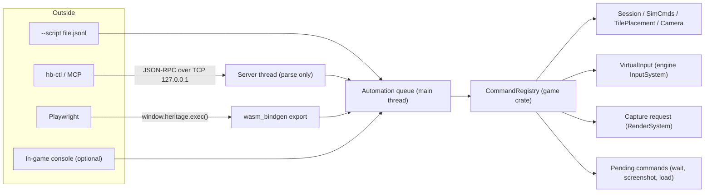

# Agent automation and in-game screenshots

**Status:** Approved 2026-10-11. Implementation not started.

This plan lets AI agents launch the game, drive it, inspect it and debug it. It also adds framebuffer screenshots, which ship to players as well. It was researched against commit `9f26ef8` on the `claude` branch. File and line references point at that commit, so re-check them before relying on them.

## How to resume this work

- Work through the [phases](#roadmap-and-progress) in order. Each phase is one PR-sized change that is usable on its own.
- Tick the checkboxes as tasks land, and add a short note under the phase (commit, anything that deviated from the plan). This file is the source of truth for progress.
- The [open decisions](#open-decisions) each have a default. Proceed with the default unless the user has decided otherwise, and record the answer here.
- Follow [AGENTS.md](../../AGENTS.md) throughout. In particular:
  - Keep both the desktop and web targets compiling.
  - Run `cargo test --workspace` before pushing.
  - Don't change `GameSession`'s serialized layout. All automation state is runtime-only, so no save-version bump or migration should be needed. If one turns out to be needed, follow the Saves workflow in AGENTS.md.
  - Route world edits through existing wrappers (`TilePlacement`, `SimCmds`, `TileMap` setters), never raw field writes.

### Working agreements

- After finishing a task and pushing, check CI once and report the result. Don't keep polling. (User preference, 2026-10-11.)

## Goals

- Agents can start the game in a known state, drive it through commands, simulated input and the UI, and observe it through state queries, logs and screenshots.
- Agent runs can be repeated: same seed, same inputs, same result.
- Players get a screenshot hotkey.
- Everything an agent can do goes through one command surface, shared by every transport.

## Summary

Nearly every gameplay mutation already goes through a deferred, name-addressable path: session commands, `SimCmds`, the player's own `TilePlacement::place`, and cheats looked up by string. Game state is serde-serializable from top to bottom. Most of the work is plumbing that turns these into one command surface and connects it to the outside world.

The plan has seven parts:

1. **One command registry** in the game crate. Named commands take JSON parameters and return JSON results. They run on the main thread at one safe point in `GameLoop::update`.
2. **Three ways in, built in this order.** First a `--script` run mode, which works for agents with nothing but bash. Then a localhost JSON-RPC server with a small `hb-ctl` CLI client. Then a `window.heritage` bridge for the web build that Playwright can drive.
3. **Deterministic time.** A fixed frame delta, plus commands that step frames or fast-forward the simulation.
4. **Simulated input** through a virtual override in `InputSystem`. Injected events alone are not enough, because ImGui, the minimap and edge scrolling poll the cursor and button state every frame.
5. **UI automation.** The retained widget layer records each widget's label and screen rect every frame, so an agent can ask for the widget tree and click a button by name.
6. **Framebuffer capture** for both renderers. Players get a PrintScreen hotkey; agents get a `screenshot` command.
7. **Observability:** state queries, a log feed with more than one listener, and frame stats.

## What exists today

| Area | Status | What the code does |
| --- | --- | --- |
| Session commands | Reusable | `GameSessionCmdQueue` already defers quit, reset map, load preset, load save and save (`crates/game/src/session.rs:42`). `GameLoop` exposes thin wrappers for these. |
| World mutation | Reusable | `SimCmds` spawns and despawns tiles, buildings, units and props, with promises you can poll (`crates/game/src/sim/commands.rs:439`). `TilePlacement::place(context, cell, tile_def, subtract_tile_cost, undo_redo)` and `TilePlacement::clear` are the player's own path, including cost and undo (`crates/game/src/menu/mod.rs:520`). `ImmediateModeSimCmds` (`sim/commands.rs:802`) exists for edits outside the sim tick. |
| Lookups | Reusable | `TileSets::for_each_tile_def` and per-category `find_tile_def_by_name` (`tile/sets.rs`), `World::find_*_by_name` and `for_each_*`, `TileMap::find_tile`, and `TileMap::find_exact_cell_for_point` for screen to cell (`tile/mod.rs:1809`). |
| Cheats | Reusable | Already set by string name through `CheatsLookup::try_set_by_name` (`crates/game/src/cheats.rs`). |
| Introspection | Reusable | `GameSession`, buildings, units, props and `GameConfigs` (`config.rs:15`) all derive serde, so any of them can be returned as JSON without new reflection code. |
| Headless sim | Proven | The integration test harness runs the simulation without a window (`crates/game/tests/test_utils/mod.rs`). `--smoke-test-saves` is a precedent for a scripted run mode (`game_loop.rs:64`). |
| Crash reporting | Partial | On desktop, a panic hook logs the message and a backtrace (`crates/engine/src/platform/desktop/crash_report.rs:61`). The web build uses `console_error_panic_hook` (`platform/web/crash_report.rs`). Nothing is written to a file or sent to a client. |
| Audio without a device | OK | Kira init failure logs an error and returns `None` instead of panicking (`sound/kira/mod.rs:63`), so headless CI should not be blocked by audio. |
| Event injection | Partial | `Application::push_event` exists for the web runner (`app/mod.rs:125`). However, ImGui reads cursor position and button state straight from `InputSystem` every frame (`UiSystem` `update_input`, `ui/mod.rs:445`), and so do the minimap (`tile/minimap.rs:718`, `731`) and camera edge scrolling. The GLFW backend reads the cursor from the OS window (`app/glfw/input.rs:23`). Pushing events alone cannot drive the UI. |
| Frame timing | Gap | `FrameClock` uses wall-clock time (`crates/common/src/time.rs:29`). How many sim ticks run depends on frame rate, so two runs of the same script can diverge. |
| Determinism | Gap | `sim/resources.rs` stores `employers` (line 171) and `employee_households` (line 353) in std `HashMap`s with random seeding, and `for_each_employer` (line 200) iterates them with early exit. See [Determinism audit](#determinism-audit). |
| Screenshots | Missing | No readback path. OpenGL draws UI onto the backbuffer after the scene blit (`render/opengl/mod.rs:216`, `222`). Wgpu creates its surface with `RENDER_ATTACHMENT` only (`render/wgpu/mod.rs:198`, `runner/web.rs:327`), and the offscreen target lacks `COPY_SRC` (`render/wgpu/target.rs:33`). |
| Logs | Partial | Logging uses channels, but `log::set_listener` allows one listener, set once (`log/mod.rs:109`), and the in-game LogViewer takes it (`debug/log_viewer.rs:171`). |
| Player notifications | Missing | There is no player-facing toast. `debug/popups.rs` is dev-only. The engine's `ui::overlay` helper (`ui/mod.rs:1093`) is a good base for a small timed message. |
| CLI | Gap | The only argument is `--smoke-test-saves`, read ad hoc with `std::env::args`. |

## Architecture

Every transport produces the same request: a method name, JSON parameters and a reply target. Requests go into one queue. The game drains that queue on the main thread, so nothing violates the `SingleThreadStatic` rule. Commands that finish in a later frame stay parked until they complete.



### Where the code lives

- `crates/engine/src/automation/` (new): the transport layer (desktop TCP thread, web export), the request queue and reply targets, `VirtualInput` and the input timeline, and PNG encoding. These are platform concerns, so they belong in the engine; AGENTS.md says `game` must not import platform crates.
- `crates/engine/src/render/capture.rs` (new): the capture API on `RenderSystem`, with one implementation per backend.
- `crates/game/src/automation/` (new): `CommandRegistry`, command handlers grouped by area (`session.rs`, `world.rs`, `ui.rs`, …), and the script runner.
- `crates/tools/hb-ctl/` (new workspace member): the CLI client, and later an MCP server.

### Execution point

Drain the queue in `GameLoop::update` right after `self.session_cmd_queue.execute(...)` (`game_loop.rs:174`) and before input events and `update_simulation`. At that point the world is unlocked, no `SimContext` is live, and the engine frame has started, so ImGui queries are valid.

- World edits go through `TilePlacement` or an `ImmediateModeSimCmds` built from a fresh context. `GameSession` needs small helpers that build a `SimContext` or `GameUiContext` from its private fields (see the `make_ui_widget_context!` macro in `session.rs`), because the borrows must be split inside the session.
- Session-level changes are pushed onto `GameSessionCmdQueue`. That queue runs at the start of the next frame, so the reply waits until it has run.
- Pending commands store IDs, never references, because a session load replaces the world under them.

## Command system

One registry, shared by every transport and by an optional in-game developer console:

```rust
pub type CommandFn = fn(&mut CommandContext, serde_json::Value) -> CommandResult;

pub enum CommandResult {
    Done(serde_json::Value),
    Failed(CommandError),             // code + message, e.g. InvalidParams, NotInGame
    Pending(Box<dyn PendingCommand>), // polled once per frame until it resolves
}

pub struct CommandContext<'a> {
    pub engine: &'a mut Engine,
    pub session: &'a mut GameSession,
    pub session_cmds: &'a mut GameSessionCmdQueue,
    pub configs: &'static GameConfigs,
    pub frame: u64,
}

// A static table is enough; no runtime registration needed.
const COMMANDS: &[CommandDef] = &[
    CommandDef { name: "world.place", desc: "Place a tile def at a cell, as a player would", run: cmd_world_place },
    // ...
];
```

- **Parameters** are typed structs with `#[derive(Deserialize)]`. Bad input becomes a clean `InvalidParams` error instead of a panic. Agents will send malformed input often, and the rest of the codebase prefers `unwrap()`.
- **Discovery.** `help` lists every command with its one-line description and parameter schema. The schema comes from a small hand-written table first, or from the `schemars` crate later. Agents learn the surface from the game itself, so docs can't drift.
- **Pending commands** cover anything that spans frames: `wait.frames`, `wait.sim_seconds`, `wait.until`, `screenshot` (GPU readback), session loads, and input gestures.
- **Same path as the player.** Placement goes through `TilePlacement::place` so cost, undo and validation behave the same as a mouse click. Raw `SimCmds` spawns stay available for test setup.
- **Tile names.** Agents won't know tile categories, so add a name-only lookup that searches every layer and category with `TileSets::for_each_tile_def`, and report ambiguous names as an error listing the matches.
- **Save and load report their result.** `GameSession::save_game` returns `bool` (and `load_save_game` too), but `GameSessionCmdQueue` discards it (see `.claude/rules/known-issues.md`). The `session.save` and `session.load_save` commands must return success or failure.
- **Panics** stay fatal, matching the codebase. Extend the existing crash reporter hook (`platform/desktop/crash_report.rs`) to also write a crash file and notify connected clients. See Phase 3.

## Transports

### Script mode (first)

`HeritageBuilder --script scenarios/smoke.jsonl` reads one command per line and runs them in order. Each line waits for the previous one to finish. Results go to stdout as JSON lines. The process exits with status 0 if every command succeeded and every assertion passed, and 1 otherwise. This copies the `--smoke-test-saves` pattern. It needs no networking and works the same in CI and in an agent session. Assertions are ordinary commands, such as `assert.gt` on a query result.

```jsonl
{"method":"session.load_preset","params":{"preset":2}}
{"method":"time.fixed_dt","params":{"dt":0.016667}}
{"method":"world.place","params":{"tile":"house_0","cell":[10,12]}}
{"method":"world.road","params":{"from":[9,10],"to":[9,20]}}
{"method":"wait.sim_seconds","params":{"secs":120}}
{"method":"assert.gt","params":{"query":"world.building_at","args":{"cell":[10,12]},"path":"/population","value":0}}
{"method":"screenshot","params":{"path":"out/smoke.png"}}
```

Tile names, cells and result paths above are illustrative; use real names from the tile sets and the actual JSON shape of query results.

Script result lines are machine-readable output written straight to stdout, not through `engine::log`. Treat this as an exception to the logging rule, like `tools/bundler`, and note it in AGENTS.md.

### Localhost JSON-RPC server (second)

- Enabled with `--automation[=PORT]` (default port 7878). `--automation=0` picks a free port, which lets several instances run side by side.
- Binds `127.0.0.1` only. At startup the game writes the port to `logs/automation.port` and a random per-launch token to `logs/automation.token` (`/logs/` is already git-ignored). A connection must send `{"method":"auth","params":{"token":"..."}}` before anything else, so other local processes can't drive the game by accident.
- Uses newline-delimited JSON-RPC 2.0. A background thread parses each request and forwards it over an `mpsc` channel. Replies come back through a per-connection channel. The thread never touches game state.
- Notifications stream log lines, panics and session changes to subscribed clients.
- `hb-ctl` is a tiny CLI so agents never write socket code:
  - `hb-ctl launch [-- game args]` starts the game with `--automation=0`, waits for `ping`, and prints the port and PID.
  - `hb-ctl call world.place '{"tile":"well","cell":[4,4]}'` prints the result, exiting with status 1 on error.
  - `hb-ctl screenshot out.png [--no-ui]`, `hb-ctl logs [--follow]`, `hb-ctl script FILE`, `hb-ctl quit`.
- Later, `hb-ctl mcp` runs as a stdio MCP server that exposes the same registry as tools (Phase 6).

### Web bridge (third)

Browsers can't open a listening socket. Instead, export `window.heritage.exec(request) → Promise<result>` through `wasm_bindgen`, feeding the same queue. Playwright drives it with `page.evaluate`. Screenshots come back as base64 PNG. Playwright's own page screenshot works as a cross-check.

## Frame and time control

Repeatable runs need control over time. Today one simulated minute is a different number of ticks on a fast machine than on a slow one.

- **`--fixed-dt SECONDS`** and `time.fixed_dt`: `FrameClock` reports a constant delta instead of wall-clock time. This one change makes tick counts depend only on frame count.
- **`time.fast_forward {sim_secs, step?}`**: runs `GameSession::update_simulation` repeatedly in fixed steps within a single frame, skipping rendering, until the target sim time is reached. Default step is 1/60 s to match normal play. Account for `sim.speed()`, and return an error while the sim is paused unless `resume: true` is passed. This is the same simulation-only loop the test harness uses, and it's much faster than waiting on vsync.
- **`frame.hold` / `frame.step {n}`**: freezes simulation and animations between agent commands, while rendering continues so screenshots still work. An agent can screenshot, inspect and act without the world moving underneath it.
- **`--seed N`** overrides `SimConfigs::random_seed`. Apply it right after `GameConfigs::load()`, before the session is created.
- A **frame counter** on `FrameClock`, returned with every reply, so logs, screenshots and commands can be lined up afterward.
- A runtime-only **sim time counter** on `Simulation` (`#[serde(skip)]`) for `wait.sim_seconds`. Skipping it in serde leaves the save layout unchanged.

### Determinism audit

`sim/resources.rs` keeps `HouseholdWorkerPool::employers` (line 171) and `employee_households` (line 353) in `std::collections::HashMap` with the default random hasher. `for_each_employer` (line 200) and `for_each_employer_mut` iterate with early exit, so which employers get visited can change between process runs even with a fixed seed. The same maps are serialized as pairs in iteration order, so save files are not byte-stable either.

Fix: switch both to a deterministic map. `BTreeMap` works if the keys implement `Ord`; otherwise use a `HashMap` with a fixed hasher. Generalize the `serialize_hash_map_as_pairs` helper to match. The serialized form stays a list of pairs, so no save-version bump is needed. Then sweep the rest of the simulation code for std hash containers that are iterated (`grep -rn "HashMap\|HashSet" crates/game/src`). Lookup-only maps, such as those in `building/config.rs`, are fine.

## Simulated input

Pushing events is only half of input. The other half is state that gets polled every frame: ImGui sets `io.mouse_pos` and `mouse_down` from `InputSystem`, camera edge scrolling uses the cursor position from `Engine::begin_frame`, and the minimap polls the left button directly. With the shipped GLFW backend, cursor position comes from the OS window.

- **Virtual state.** Add a `VirtualInput` layer inside the frontend `InputSystem`, above both backends. It holds cursor position, button states, key states and modifiers. When it's active, `cursor_pos()`, `mouse_button_state()` and `key_state()` return virtual values.
- **Synthetic events need their own queue.** The web runner already uses `Application::push_event` for real browser input, so synthetic events can't share it. Add `Application::push_synthetic_event`, merged in `poll_events`, so routing in `Engine::poll_app_events` stays unchanged.
- **Input capture mode.** While an agent drives, real input events are dropped (except `Quit` and `WindowResize`), and cursor confinement stops warping the real cursor (see `confine_cursor_to_window` in `app/winit/mod.rs`; check the GLFW path too). Otherwise the user's real mouse resting near a window edge would scroll the map in the middle of a test. A visible "AUTOMATION" badge, drawn with `ui::overlay`, makes the mode obvious.
- **Frame-spread gestures.** Mouse state is polled once per frame, so a press and release in the same frame is never seen. An engine-level input timeline applies one step per frame at the start of `Engine::begin_frame`, before events are polled and before ImGui reads the state. High-level gestures expand into steps:
  - `input.click`: move, then press on the next frame, then release on the frame after.
  - `input.drag`: interpolates the cursor across frames, which road placement needs.
  - `input.type`: sends characters.

  The command stays pending until its steps are consumed.
- **Coordinate helpers.** `camera.cell_to_screen`, and a `cell` target on `input.click`, so agents can say "click cell (10,12)". The cell is converted with the camera's `WorldToScreenTransform`, and the camera teleports first (`Camera::teleport`) if the cell is off screen.

Coordinates are in window points, which is what `InputSystem` already uses. On HiDPI screens screenshots are in framebuffer pixels, so the `screenshot` reply includes the scale factor between them.

## UI automation

The game's own menus (HUD, dialogs, home menu) are built from retained widgets in `crates/engine/src/ui/widgets.rs` (`UiMenu`, `UiTextButton`, `UiSpriteButton`, `UiSlider`, `UiDropdown`, …). Each has a label and draws as one ImGui item. That makes a widget tree cheap to build.

- **Per-frame widget registry.** Each leaf widget records `{path, kind, label, rect, enabled, hovered}` in its own `draw`, right after its ImGui item call, using `item_rect_min` / `item_rect_size`. `UiMenu` and the group layouts push and pop a path segment around their children; the child draw sites are `widgets.rs:687`, `internal.rs:244` and `internal.rs:337`. The registry is cleared at `UiSystem::begin_frame` and only records while automation is on, so a normal session pays nothing. Duplicate paths get a `#n` suffix.
- **`ui.tree`** returns the registry: every visible widget with a stable path such as `"Main Menu/Load Game"`.
- **`ui.click {path}`** resolves the widget's rect from the latest registry and clicks its center with the input timeline. This is a true end-to-end click, with the same hover, sound and callback behavior as a player's. It fails if the widget is missing or disabled.
- **`ui.set {path, value}`** for sliders, checkboxes, text inputs and dropdowns. Dragging a slider to an exact value with simulated input is fragile, so this writes through the widget's own `on_update_value` callback instead. The callback needs a widget context, so queue the value in `UiSystem` and apply it during that widget's next `draw`.
- **`dialog.open` / `dialog.close` / `dialog.current`** wrap the existing `menu::dialog` functions.

The developer editor menus are immediate-mode ImGui and have no retained layer. For those, agents fall back to coordinates plus screenshots. A small `automation_id` helper in the debug UI could close that gap later if it matters.

## Screenshots

The same mechanism serves players and agents. A capture is requested during a frame and filled in at the end of the backend's `end_frame`, after UI has drawn and before present (`app.present()` runs after `RenderSystem::end_frame`; for GLFW the swap is `app/glfw/mod.rs:117`). The result is RGBA8 pixels with a top-left origin, plus size and scale. It arrives that frame on OpenGL, and a frame or more later on Wgpu.

### OpenGL (desktop default)

In `OpenGlRenderSystem::end_frame`, after `ui_frame_bundle.render()` (`render/opengl/mod.rs:222`), read the back buffer at framebuffer size: bind the default framebuffer for reading, set `GL_PACK_ALIGNMENT` to 1, call `glReadPixels` with `GL_RGBA`/`GL_UNSIGNED_BYTE`, and flip rows (GL's origin is bottom-left). It's synchronous and simple. To avoid a stall in the hotkey path, it can later read into a pixel buffer object and map it on the next frame.

### Wgpu (desktop and web)

- The surface is configured with `RENDER_ATTACHMENT` only, and `COPY_SRC` support on surfaces varies by backend (the web build may fall back to WebGL). The portable approach: on capture frames, run the blit pass and the UI pass a second time into a capture texture with `RENDER_ATTACHMENT | COPY_SRC`. Create that texture in the surface format, so the existing blit and UI pipelines can render into it unchanged. Batches and UI draw commands are already recorded at that point, so the extra passes cost something only on capture frames.
- Copy the texture into a `MAP_READ` buffer with `copy_texture_to_buffer`, padding rows to `wgpu::COPY_BYTES_PER_ROW_ALIGNMENT` (256), then call `map_async`. On desktop, poll the device on the same or next frame. On web, resolve in the map callback, which is why `screenshot` is a pending command.
- Strip row padding, and swap channels when the surface format is BGRA. The code picks a non-sRGB surface format on purpose (`render/wgpu/mod.rs:191`), so bytes pass straight through with no gamma conversion.
- For scene-only captures, add `COPY_SRC` to the offscreen target's usage (`render/wgpu/target.rs:33`) and copy from it.

### Options

- `include_ui` (default true). Setting it to false captures the offscreen scene target, which helps agents check world rendering without menus in the way. The offscreen target is sized `max(viewport, framebuffer)` on both backends.
- `region` (a cell range or screen rect) for crops, and `scale` for downsampled thumbnails, which keep agent context small.
- Output as a file path, or as base64 PNG in the reply. PNG encoding uses the `image` crate, which the engine already depends on.

### As a player feature

- PrintScreen (and F12, since Mac keyboards lack PrintScreen) saves `screenshots/Heritage Builder 2026-10-10 14-03-22.png` next to `saves/`, then shows a short message with the file name. There's no toast widget yet; build a small timed one on `ui::overlay`.
- Handle the key in `GameLoop::handle_app_event`. Key events reach it only if ImGui didn't consume them, so typing in a text field won't trigger a capture.
- There's no date-time crate in the workspace. To build the file name, either format UTC from `SystemTime` with a small civil-date helper, use `libc::localtime_r` (`libc` is already a desktop dependency of the engine), or add a crate such as `time`.
- Encode and write the PNG on a background thread on desktop, so the hotkey never causes a frame hitch.
- Optional: a Settings toggle for "hide interface in screenshots".
- On web, the PNG downloads through a Blob and an anchor element created by the page. That needs extra `web-sys` features (`Blob`, `BlobPropertyBag`, `Url`, `HtmlAnchorElement`), so it lands in Phase 5.

## State, logs, stats

- **Queries** return serde JSON straight from the game's own types: `world.inspect {kind, id}`, `world.building_at {cell}`, `world.list {kind}`, `tile.at {cell, layer}`, `sim.state` (paused, speed, treasury, date), `world.stats`, and `session.state` (menus mode, map size, current campaign mission). An optional `fields` filter (a list of JSON pointers) keeps replies small.
- **Log fan-out.** Replace the single `OnceLock` listener with a small listener list, so LogViewer, the automation server and the crash report can all listen. Pass records by reference. Listeners must not log, or must be called without holding the list lock, to avoid deadlocks. Give every record a sequence number, and keep a ring buffer of recent records for `logs.tail {since, min_level, channel}` and for crash reports.
- **Stats.** `debug.stats` returns `GameLoopStats` and `RenderStats`: frame time breakdown, draw calls and triangle counts.
- **Save as a snapshot.** `session.save` already gives a complete, diffable state dump. A `session.dump` command can return it inline for small maps.

## Command catalog (v1)

| Group | Methods | What they do | Built on |
| --- | --- | --- | --- |
| Meta | `ping`, `help`, `version`, `quit` | Liveness check, command list with schemas, build info, clean exit | `GameLoop::quit_game` |
| Time | `time.fixed_dt`, `time.fast_forward` | Constant delta; run N sim seconds in one frame | `FrameClock`, `GameSession::update_simulation` |
| Time | `frame.hold`, `frame.step`, `wait.frames`, `wait.sim_seconds`, `wait.until` | Pause, step and sync with the game | Pending commands |
| Session | `session.new_map`, `session.load_preset`, `session.load_save`, `session.save`, `session.quit_to_menu`, `session.state` | Start, load and save games | `GameSessionCmdQueue` |
| Session | `menus.mode` | Switch between HUD and dev editor | `push_toggle_menus_mode` |
| Simulation | `sim.pause`, `sim.resume`, `sim.speed`, `sim.state` | Control and read the sim | `Simulation` API |
| Simulation | `cheats.list`, `cheats.set` | Toggle cheats by name | `CheatsLookup` |
| Simulation | `config.get`, `config.set` | Read and patch configs as JSON | serde on `GameConfigs` |
| World | `world.place`, `world.clear`, `world.road` | Place and remove as a player would | `TilePlacement::place` / `clear`; road segment logic in `menu/mod.rs:418–476` |
| World | `world.spawn_unit`, `world.despawn` | Direct spawning for test setup | `SimCmds` promises |
| World | `world.inspect`, `world.list`, `world.building_at`, `tile.at`, `world.stats` | Read state as JSON | `World::find_*`, serde |
| World | `undo`, `redo` | Exercise undo history | `undo_redo` |
| Camera | `camera.teleport`, `camera.zoom`, `camera.cell_to_screen`, `camera.screen_to_cell` | Frame shots and convert coordinates | `Camera`, `find_exact_cell_for_point` |
| Input | `input.capture`, `input.move`, `input.click`, `input.drag`, `input.key`, `input.type`, `input.scroll` | Simulated mouse and keyboard | `VirtualInput`, synthetic events |
| UI | `ui.tree`, `ui.click`, `ui.set`, `dialog.open`, `dialog.close`, `dialog.current` | Find and operate widgets by name | Widget registry, `menu::dialog` |
| Observe | `screenshot` | Capture the frame to a file or base64 | Render capture |
| Observe | `logs.tail`, `logs.subscribe`, `debug.stats` | Logs and performance | Log fan-out, `GameLoopStats` |
| Assert | `assert.eq`, `assert.ne`, `assert.gt`, `assert.lt`, `assert.exists` | Checks for script mode | Query commands |

Road placement today is driven by the menus' `TilePlacement::update_road_segment` and the private `try_place_road_segment`. `world.road` needs a public function that builds a segment between two cells and places it.

## Roadmap and progress

### Phase 0: Foundations (small)

- [ ] Command-line module in the engine. Desktop reads `std::env::args`; web returns defaults for now (URL query parameters can come later). Flags:
  - `--fixed-dt SECONDS`
  - `--seed N`
  - `--window-size WxH`
  - `--map preset:N`
  - `--load-save NAME`
  - `--skip-home-menu`

  Move `--smoke-test-saves` into it.
- [ ] Fixed-delta mode on `FrameClock` (`Engine::set_fixed_delta_time`), and a frame counter.
- [ ] Log fan-out with multiple listeners, sequence numbers, and a recent-records ring buffer. Update `debug/log_viewer.rs` to the new API.
- [ ] Deterministic maps in `sim/resources.rs`, and a sweep of other iterated std hash containers in simulation code.

Done when:
- `cargo test --workspace` passes, and desktop and web build.
- A unit test shows `FrameClock` returns the fixed delta when set.
- A unit test shows two log listeners both receive a record.
- `--smoke-test-saves` still works through the new module.

### Phase 1: Screenshots (medium)

- [ ] `render/capture.rs`: `CaptureRequest { include_ui }` and `CapturedImage { size, scale, pixels }` (RGBA8, top-left origin), plus `RenderSystem::request_capture` and `take_capture`, backed by new `RenderSystemBackend` methods.
- [ ] OpenGL readback (back buffer, plus offscreen target for scene-only).
- [ ] Wgpu readback on desktop (capture texture, padded copy, map, swizzle). It should compile for web, but web testing waits for Phase 5.
- [ ] PrintScreen / F12 hotkey, `screenshots/` folder, timed message, PNG encoding off the main thread. Add `/screenshots/` and `/out/` to `.gitignore`.
- [ ] One-shot mode: `--screenshot-after-frames N --screenshot-out PATH` captures after N frames, writes the PNG, and quits with status 0.

Done when:
- The hotkey writes a PNG that matches the screen, UI included, on OpenGL (the shipped config) and on Wgpu (`engine.render_api = "Wgpu"`), at framebuffer resolution on a HiDPI Mac.
- `include_ui: false` produces a scene-only image.
- `cargo run -p HeritageBuilder -- --skip-home-menu --map preset:1 --fixed-dt 0.016667 --screenshot-after-frames 120 --screenshot-out out/shot.png` writes the image and exits 0.

### Phase 2: Command registry and script mode (medium)

- [ ] `crates/game/src/automation/`: `CommandRegistry`, `CommandContext`, `CommandResult`, `CommandError`, `PendingCommand`, dispatch at the execution point above.
- [ ] Engine-side request queue and reply targets, shaped so Phase 3's channel and Phase 5's web bridge slot in.
- [ ] `GameSession` helpers for building a `SimContext` / `GameUiContext`, and `pub(crate)` save/load that report their result.
- [ ] Commands: meta, time, session, sim, cheats, config, world, camera, observe (`screenshot`, `logs.tail`, `debug.stats`) and assert.
- [ ] `--script FILE`: JSON lines in (blank lines and `#` comments allowed), JSON lines out, stop at the first failure (`--script-continue-on-error` to keep going), exit status 0/1. Autosave off in this mode, as in the smoke test.
- [ ] Exit-code plumbing: the desktop runner currently returns `()`. Add a way for the run loop to report an exit code (for example `RunLoop::exit_code()`), and call `std::process::exit` after a clean shutdown.
- [ ] Sample scenarios in `scenarios/`: `smoke.jsonl` (load, place, fast-forward, assert, screenshot) and `determinism.jsonl`.
- [ ] Optional in-game console (see open decision Q3).
- [ ] AGENTS.md: document `--script`, the scenario format, `help`, and the stdout exception to the logging rule.

Done when:
- `cargo run -p HeritageBuilder -- --script scenarios/smoke.jsonl` exits 0 and prints JSON lines; a failing assertion exits 1.
- `help` lists every command with its description and parameters.
- Malformed parameters return `InvalidParams` and never panic.
- Running `determinism.jsonl` twice with the same `--seed` and `--fixed-dt` produces byte-identical saves.
- The registry compiles on web (script mode itself is desktop-only).

### Phase 3: Live control server (medium)

- [ ] `crates/engine/src/automation/server.rs` (desktop only): loopback listener, per-connection reader and writer threads, newline-delimited JSON-RPC 2.0, `auth` handshake, port and token files in `logs/`. If an explicitly requested port is taken, fail fast with a clear message.
- [ ] Main thread drains the channel into the Phase 2 dispatcher. Pending replies keep their connection's reply sender.
- [ ] Notifications: `logs.subscribe` (through a log listener), `panic`, session changes.
- [ ] Extend the crash reporter hook: write `logs/crash-<timestamp>.txt` with the message, backtrace, recent log records and frame number, and send a `panic` notification before exit.
- [ ] `crates/tools/hb-ctl` (add to workspace members): `launch`, `call`, `screenshot`, `logs`, `script`, `quit`. Uses std networking and `serde_json` only.
- [ ] AGENTS.md: how to launch and drive a live instance.

Done when:
- `hb-ctl launch`, then `hb-ctl call ping`, works. `hb-ctl screenshot` writes a PNG, and `hb-ctl logs --follow` streams.
- Requests before `auth` are rejected, and the server binds loopback only.
- A forced panic produces a crash file and a `panic` notification.
- The web build is unaffected.

### Phase 4: Simulated input and UI automation (large)

- [ ] `VirtualInput` in `InputSystem`, `Application::push_synthetic_event`, and input capture mode with the badge.
- [ ] Engine input timeline applied at the start of `Engine::begin_frame`. Gestures: click, drag, key, type, scroll.
- [ ] `camera.cell_to_screen` / `camera.screen_to_cell`, and `cell` targets on input commands.
- [ ] Widget registry in `UiSystem`, leaf-widget recording, and path segments in menus and groups.
- [ ] `ui.tree`, `ui.click`, `ui.set`, `dialog.open` / `dialog.close` / `dialog.current`.

Done when:
- A script starts a new game from the home menu using only `ui.click`.
- A script picks a building in the HUD palette with `ui.click` and places it with `input.click {cell}`.
- Real mouse movement has no effect while capture is on, and turning capture off restores normal input.
- `ui.tree` rects line up with what screenshots show.

### Phase 5: Web and CI (medium)

- [ ] `window.heritage.exec` bridge (`wasm_bindgen` export, plus glue in `web/bootstrap.js`), feeding the same queue. Replies resolve promises by request ID.
- [ ] Verify Wgpu capture on web, including the asynchronous map. Screenshots return base64.
- [ ] Web screenshot hotkey through a Blob download (add the `web-sys` features).
- [ ] Playwright smoke script: serve `web/`, wait for the game, call `ping`, load a preset, take a screenshot. Chromium is preinstalled in Claude Code cloud sessions (`/opt/pw-browsers`).
- [ ] CI job on Ubuntu:
  - Install Xvfb and Mesa.
  - Build release.
  - Run `xvfb-run -a cargo run -p HeritageBuilder --release -- --script scenarios/smoke.jsonl`.
  - Upload `out/*.png` as a workflow artifact.

Done when:
- The Playwright script gets a screenshot from the web build.
- The CI job runs the scenarios green and uploads screenshots.

### Phase 6: Agent ergonomics (small to medium)

- [ ] `hb-ctl mcp`: stdio MCP server with `initialize`, `tools/list` and `tools/call`. It maps each registry command to a tool using the schemas from `help`, and `screenshot` returns image content. Add a project `.mcp.json` so Claude Code picks it up.
- [ ] `.claude/skills/drive-game/SKILL.md`: launching, driving, screenshots, and common debugging recipes. List it in AGENTS.md.
- [ ] `--record FILE` / `--replay FILE`: real input events and commands per frame as JSON lines, replayed with fixed delta and seed. Useful for bug reports.
- [ ] Optional `assert.image {path, golden, tolerance}`, for same-machine, same-backend comparisons only.

Done when: a local Claude Code session lists the game's tools over MCP, and can take a screenshot and place a building through them.

## Risks

| Risk | Mitigation |
| --- | --- |
| The server thread touches a `SingleThreadStatic` and asserts. | The thread only parses JSON and moves owned strings across channels. Every handler runs on the main thread. Add a debug assert on `is_main_thread()` in the dispatcher. |
| The automation port is a remote-control surface in shipped builds. | Off by default. Loopback only, with a per-launch token. Behind an `automation` cargo feature that release bundles can leave out (see Q1). Screenshots don't need the server and always ship. |
| CI has no GPU or display. | `xvfb-run` with Mesa llvmpipe for OpenGL, or lavapipe for Wgpu. Audio init already fails gracefully. Where no display is available, fall back to script mode with `time.fast_forward` and no screenshots. |
| Golden screenshots differ across GPUs and drivers. | Only compare images from the same machine and backend, with a tolerance. Prefer state assertions in CI, and use screenshots for agents and humans to look at. |
| Frame rate is capped by vsync (Wgpu uses `PresentMode::Fifo`; GL depends on the driver's default swap interval). | Use `time.fast_forward` for long stretches. Optionally add `--no-vsync` for automation runs. |
| macOS requires GLFW to stay on the main thread. | Already true. The new threads do no windowing. |
| Commands bypass invariants that the `TileMap` wrappers protect. | Handlers only call existing wrappers (`TilePlacement`, `SimCmds`, `TileMap` setters), never raw fields. |
| Long `time.fast_forward` calls stall the frame. | Cap the iterations per frame, and continue across frames as a pending command when the target is large. |

## Open decisions

Each has a default to use until the user decides otherwise. Record answers here.

- **Q1. Shipping scope of the server.** Should the live control server ship in release builds behind a flag, for modders and support, or stay dev-only?
  *Default:* compile it into desktop builds behind an `automation` cargo feature that is on by default, and keep it off at runtime unless `--automation` is passed. Release bundles can turn the feature off. Screenshots ship either way.
- **Q2. MCP priority.** Should `hb-ctl mcp` move ahead of UI automation? It makes the biggest difference to how Claude Code uses the game, and it only needs Phase 3 (the server and `help`).
  *Default:* keep it in Phase 6, but it may start any time after Phase 3.
- **Q3. Console UI.** Should Phase 2 include a visible in-game developer console on the same registry?
  *Default:* no. Revisit after Phase 3; the registry makes it cheap to add later.
- **Q4. Where scenarios live.** A top-level `scenarios/` folder, or `crates/game/tests/scenarios/` next to the integration tests?
  *Default:* top-level `scenarios/`, since the game binary runs them, not `cargo test`.
