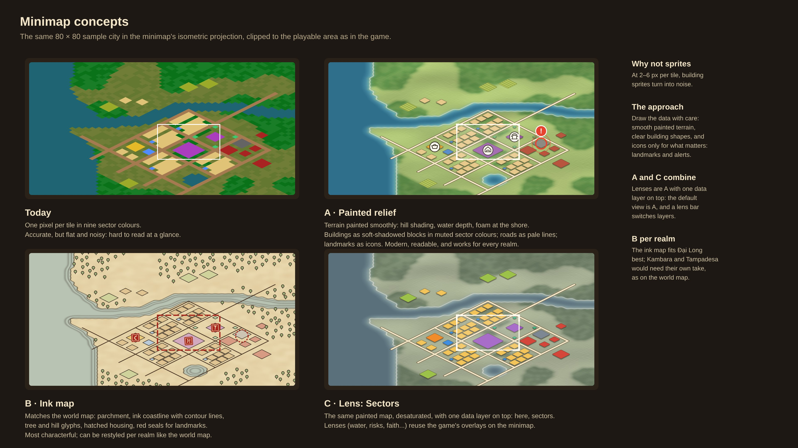

# Minimap: painted relief, lenses and tools

**Status (2026-11-07): Done.** Phases 0–5 landed on `claude`; the [notes](#notes-2026-11-07) record the deviations and what was verified. The Risk, Faith, Flood and Fertility lenses come with M6, M8 and M7. This plan turns the minimap concepts in [docs/design/mockups/](../design/mockups/README.md#minimap) into code: concept A (painted relief) as the default view, concept C (lenses) on top of it, and a toolbar. It is milestone MM of the [roadmap](roadmap.md). It was researched against `701b947` on `claude`. File and line references point at that commit, so re-check them before relying on them.



## How to resume this work

- Work through the [phases](#phases) in order. Each phase is one PR-sized change that is usable on its own, and Phase 0 changes nothing visible.
- Tick the checkboxes as tasks land, and add a short dated note under the phase (commit, deviations, what was verified). This file is the source of truth for progress.
- The [open decisions](#open-decisions) each have a default. Proceed with the default unless the user has decided otherwise, and record the answer here.
- The mockup generator's `minimap.py` (`docs/design/mockups/generator/`) is the visual reference. Its constants (colours, blur radii, foam width, shadow offset) are the starting values for the style file, and `serve.py` shows changes to it live.
- Follow [AGENTS.md](../../AGENTS.md) throughout:
  - Keep desktop and web compiling: everything here runs on both.
  - Only `engine/src/ui/immediate.rs` and the retained widgets call egui: new drawing goes through `UiPainter`.
  - Run `cargo test --workspace` and the scenario scripts before pushing.
  - No save-format change: the minimap is rebuilt on load (`#[serde(skip)]` on `TileMap::minimap`, `tile/mod.rs:2176`).

## Goals

1. **A painted minimap (concept A):** soft terrain with shaded water depth, a foam line on shores and blurred forest and rock masses, instead of one noisy pixel per tile. Buildings are crisp blocks in muted sector colours with a small drop shadow; fields show a stripe pattern; roads are pale lines. Only landmarks and alerts get icons.
2. **Same behaviour as today:** the isometric diamond clipped to the playable rectangle, click and drag to move the camera, auto zoom and auto scroll on large maps, the camera frame, alert icons. Nothing about picking or the transforms changes.
3. **Lenses (concept C):** a lens bar (City, Sectors, Water, then Risks, Faith, Floods as their milestones land) that dims the base and shows one data layer: a smooth heat field plus building colours.
4. **Tools:** zoom in and out, jump to the next alert (with a count), centre on the city's seat (palace or governor's house), open the world map, collapse.
5. **Realm styles as data:** palette, frame and icons per realm in a JSON style file, hot-reloadable. Đại Long ships first; Kambara and Tampadesa are new files, not code.
6. **Cheap:** a full rebuild is a one-off on load (tens of milliseconds in release builds); an edit updates only the patch around it; per-frame cost is a few hundred egui shapes.

**Not goals:** sprites on the minimap (they turn to noise at 2–6 px per tile), a GPU shader path, animated water, rotating the map, concept B (the ink map) as a shipped style. B stays possible: it's a different style file plus a glyph layer (see [Later](#later)).

## What exists today

**Model and texture** (`crates/game/src/tile/minimap.rs`, 1,654 lines):
- `Minimap { texture: MinimapTexture, icons: Vec<MinimapIconInstance>, widget: MinimapWidget, rng }` (`:402`), owned by `TileMap` and rebuilt in `post_load` (`:443`).
- `MinimapTexture` (`:205`) holds one RGBA pixel per cell, uploaded whole to a `Nearest`-filtered texture named `"minimap"` whenever anything changed (`update`, `:245`). `TextureCache::update_texture` can already update a sub-rectangle (`engine/src/render/texture.rs:278`), but it isn't used that way.
- Colours come from `MinimapTileColor::from_tile_def` (`:169`): from `path_kind` (empty land, vacant lot, water, road, rocks, vegetation), then from `sector` for buildings (`:154`). Land, vegetation and rocks alternate between two shades at random (`alternate`, `:150`).
- Edits arrive through `Minimap::place_tile` (`:483`) and `clear_tile` (`:495`), called from `TileMap`'s placement paths (`tile/mod.rs:2705`, `:2735`, `:2772`).
- Alerts: `push_icon(MinimapIcon::Alert, cell, tint, lifetime)` (`:517`), faded out over 5 s. `MinimapIcon` has one variant.

**Widget and drawing:**
- `MinimapWidget` (`:680`) does the maths: the diamond (the axis-aligned widget rect rotated −45°), the playable inner rect used as clip rect, zoom and UV offsets, auto zoom to about 95×95 visible cells (`desired_visible_cells`), auto scroll at the edges, picking (`pick_cursor_pos`), and the camera rect.
- `BaseMinimapRenderer` (`:1100`) builds a retained `UiMenu` ("Minimap", no title bar) with a "Map" heading, an optional debug button and a close button, plus a separate one-button menu to open it again. The buttons are `UiSpriteButton`s from `assets/ui/buttons/minimap/{open,close,debug}_{idle,hovered,pressed,disabled}.png`.
- It draws through `ui::painter(ui_sys, UiLayer::Window)`: `image_quad` maps the texture's UV window onto the diamond's corners (`:1336`), clipped to the playable rect; `rect` draws the camera frame and outline (`:1363`); `image` draws icons (`:1373`).
- `DevUiMinimapRenderer` (`:1459`) adds debug controls. The dev editor and the retail HUD share all of the above.

**Engine:**
- `UiPainter` (`engine/src/ui/immediate.rs:1936`) wraps an `egui::Painter` but exposes only `rect`, `rect_filled`, `circle`, `circle_filled`, `text`, `image` and `image_quad`.
- egui 0.37 core only, no eframe: the engine runs its own loop and renders egui's output itself (`UiDrawData` in `render/ui_draw.rs`, one indexed draw per command in both backends, premultiplied alpha, straight-alpha textures). Any `egui::Shape`, including meshes with our own textures (`TextureId::User`, `ui/renderer.rs:144`), reaches the screen through that path.
- `TextureSettings` has `Linear` filtering and `Repeat` wrapping (`render/texture.rs:87`).

**Data:** `TileDef` (`tile/sets.rs:563`) has `path_kind`, `sector`, `color` (unused by the minimap), `cost`, `materials` and `construction`. Nothing says "this is a field", "this is a landmark" or which icon it gets. The Blender generator's catalog entries carry a `tile_set` block that `sync_tileset.py` merges into `tile_set.json`, checked in CI.

## Design

### Rendering: a baked raster base plus egui shapes

The look splits cleanly into two kinds of content, and each gets the tool that suits it:

| Content | How it's drawn | Why |
|---|---|---|
| Terrain: land colour, forests, rocks, water depth, foam | **Baked on the CPU** into an RGBA texture at 4–8 px per cell, `Linear` filtered, drawn with the existing `image_quad` | It's soft, blurred and noise-textured: per-pixel work that a rasteriser does badly and a bake does once. It only changes when terrain is placed. |
| Buildings, fields, roads, bridges | **egui shapes**, built from a cached list in map space and transformed each frame | They must stay crisp at any zoom, and there are only hundreds of them. egui tessellates and anti-aliases them (feathering) and they travel the same UI path as everything else. |
| Camera frame, pings, landmark and alert icons, lens legend | **egui shapes and textured quads** in screen space | They're UI, drawn on top, and some animate. |
| Lens heat field | **A small per-cell texture** (N×N RGBA), `Linear` filtered, drawn as a second `image_quad` over a dimming veil | The GPU's bilinear filter smooths a per-cell value into a soft gradient for free. |

**Do we need vector graphics?** Only in the small sense egui already provides: filled convex polygons, strokes and meshes with anti-aliased edges. No SVG, no path library. Every shape here is a quad, a polyline, a circle or a textured quad.

**Can we use egui/eframe?** egui yes, eframe no:
- egui's painter is already how the minimap draws, and `epaint` gives everything the crisp layer needs: `Shape::convex_polygon` and `Shape::line_segment` with feathered anti-aliasing, `Shape::mesh` for batched quads and for textured quads with any UVs, `Shape::Circle` for pings.
- eframe is egui's own app framework: it would replace the engine's runner, windowing and renderers. It has nothing the minimap needs.

**Do we roll our own renderer?** No:
- A custom GPU path would need a new pipeline and shader in both backends (OpenGL and Wgpu), integration with the UI pass, scissoring and the capture path. All of that buys effects we don't need, such as per-frame animated terrain.
- The CPU bake is a few dozen milliseconds for a full rebuild, and well under a millisecond per edit. It runs identically on desktop and web and is easy to test, since it's a pure function from grids to pixels.

**Alternatives considered:**
- **Bake everything into one texture**, buildings included, with a CPU vector rasteriser such as `tiny-skia`: one draw call and constant cost at any zoom. But buildings go soft when zoomed in, every building edit re-rasterises a patch, and it adds a dependency. Keep it as the fallback if egui tessellation ever shows up in profiles (see [Performance](#performance)).
- **Keep one pixel per cell and smooth it on the GPU** with `Linear` filtering: cheap, but it gives blurry blobs, not shores or depth.

### Data model

Split what the minimap knows from how it's drawn, so the bake, the shapes and the lenses read the same data:

```rust
// tile/minimap/model.rs
pub enum MinimapTerrain { Land, Water, Vegetation, Rocks, VacantLot }   // from path_kind, as today

pub struct MinimapGrid {            // one entry per cell, row-major like the texture today
    size: Size,
    terrain: Vec<MinimapTerrain>,
    road: BitVec,                   // road or bridge on the cell
    bridge: BitVec,
    dirty: Option<CellRect>,        // union of edited cells since the last bake, terrain only
}

pub struct MinimapFeature {         // one per building, field or plaza
    base_cell: Cell,
    size: Size,                     // footprint in cells
    class: MinimapClass,            // Building, Field, Plaza, Decor
    sector: TileSector,
    landmark: Option<LandmarkKind>, // Seat, Temple, Market, Monument, ... (from tile data, see Art)
    state: FeatureState,            // Normal, UnderConstruction, Renovating, Damaged (later: OnFire)
}

pub struct MinimapFeatures {
    by_cell: HashMap<Cell, FeatureId>,   // base cell -> feature, for clear_tile
    features: Slab<MinimapFeature>,
    shapes_dirty: bool,                  // rebuild the cached shape list
}
```

- `place_tile` and `clear_tile` keep their signatures. They update the grid (terrain cells mark `dirty`) or the feature list (`shapes_dirty`).
- Construction sites and renovations come from the building's tile flags (`TileFlags::UnderConstruction`, `Renovating`); `TileMap` already sets those through `set_tile_flags`, which gets a small hook to update `FeatureState`.
- The random two-shade alternation and `MinimapRng` go away: texture now comes from a fixed noise texture, so the minimap is deterministic and needs no RNG.

### The bake

A pure function in `tile/minimap/bake.rs`, no engine types, so it's unit-testable:

```rust
pub struct BakeInput<'a> { grid: &'a MinimapGrid, style: &'a MinimapStyle, noise: &'a NoiseTexture, elevation: Option<&'a [f32]> }

// Writes RGBA8 pixels for `cells` (plus nothing outside it) into `out`, which covers the whole map.
pub fn bake_region(input: &BakeInput, cells: CellRect, px_per_cell: u32, scratch: &mut BakeScratch, out: &mut [u8]);
```

Steps, matching `minimap.py` (`Minimap.painted`):
1. **Masks:** per-cell 0/1 masks for water, vegetation and rocks, over `cells` grown by the [margin](#incremental-updates).
2. **Upsample and blur:** bilinear upsample to pixels, then a separable blur. Three box-blur passes approximate a Gaussian and cost O(1) per pixel whatever the radius. The radii come from the style in cells (water 0.3, vegetation 0.4, rocks 0.4), times `px_per_cell`.
3. **Water depth:** a chamfer distance transform (two passes, 3–4 weights) on the water mask, in cells, capped at `max_depth_cells` (style; 6). Upsampled bilinearly and remapped to 0..1. This replaces the mockup's wide blur: it's exact, cheap and local.
4. **Elevation:** until terrain height lands (milestone T), a smooth value-noise field seeded from the map size, so the same map always looks the same. Once T lands, the cell elevation, upsampled. The hill shading is the dot product of the elevation gradient with a light from the north-west, clamped to the style's range.
5. **Land colour:** lerp `land_low` → `land_high` by elevation; mix `forest` by the blurred vegetation mask times the noise texture; mix `rocks`; multiply by the hill shading.
6. **Water colour:** lerp `water_shallow` → `water_deep` by depth; composite land over water by the blurred water mask; add `foam` where the mask is near 0.5 (a Gaussian band of the style's width).
7. **Vacant lots:** a flat tint, as today, so lots stay visible.
8. Write straight-alpha RGBA8 (the UI shaders premultiply).

**Resolution:** `px_per_cell = clamp(floor(max_texture_side / map_side), 2, 8)`, with `max_texture_side` in the style (default 1024). That gives 8 px per cell up to 128 × 128 maps (1024², 4 MB) and 4 px at 256 × 256 (1024², 4 MB). The widget shows about 95 cells across roughly 300 points (600 pixels at 2× display scale), so 4–8 px per cell is about one texel per screen pixel.

**Incremental updates:** an edit marks its cells dirty. Once a frame, `Minimap::update` grows the dirty rect by `margin = ceil(max(blur radii) + max_depth_cells)` cells, bakes that region, and uploads it with `update_texture(handle, x, y, size, 0, pixels)`. That's 15 × 15 cells for a typical edit, about 100 × 100 pixels. A per-frame budget (style: 4,096 cells) splits large changes such as a whole new map across frames, with the rest staying dirty. A full rebuild (load, new map) bakes everything synchronously.
- `update_texture` needs the sub-rect's pixels contiguous: copy the region's rows into a scratch buffer first.
- Scratch buffers live in `BakeScratch` and are reused; nothing allocates per frame.
- On desktop, the full rebuild can split rows across threads with `rayon`, behind `#[cfg(feature = "desktop")]`. Web runs single-threaded. Measure before adding it.

### The shape layer

`tile/minimap/shapes.rs` turns `MinimapFeatures` and the road bits into a cached list, rebuilt only when `shapes_dirty`:

```rust
struct ShapeCache {
    quads: Vec<MapQuad>,          // buildings, shadows, plazas: 4 corners in map cell space, colour, layer
    fields: Vec<MapQuad>,         // textured with the stripe texture, UVs in cells so stripes tile
    roads: Vec<[Vec2; 2]>,        // segments between road cell centres (right and down neighbours), like minimap.py
    landmarks: Vec<(Vec2, LandmarkKind)>,
}
```

Each frame, the renderer:
1. **Maps cells to screen** with the widget's existing transform (`cell_to_scaled_minimap_widget_px` and the −45° rotation). Precompute it as one 2×3 affine matrix per frame, since it's linear; then each vertex is one multiply-add.
2. **Culls** shapes outside the visible UV window (zoomed-in maps show a fraction of the city).
3. **Draws in order**, all clipped to the playable rect with `painter.clipped`:
   1. shadows: each building quad offset by the style's shadow vector (0.32 cells), shadow colour;
   2. fields: one textured mesh with the stripe texture (`Repeat` wrap);
   3. roads: a casing stroke, then the road stroke, widths in cells times the screen scale, round caps. Bridges are a third colour;
   4. buildings: filled quads in the sector colour with a thin darker outline;
   5. landmark icons in screen space, a fixed size, only when the zoom shows the building at 6 px or more.
4. **Batches:** shadows and buildings go into one `egui::Mesh` each (untextured, the White texture), not one `Shape` per building, so the tessellator isn't involved and the cost is just the vertices. Untextured meshes have no anti-aliasing, so add a one-pixel feather ring per quad (8 extra vertices, alpha 0 on the outside), or draw the outlines as `convex_polygon` strokes, which egui feathers. Start with the feather ring; it's the cheaper of the two.

**Level of detail:** below 1.5 px per cell, skip shadows, outlines and road casings, and draw roads one pixel wide. Below 0.75 px per cell, skip roads.

**States:** construction sites draw as an outline with a dashed fill pattern in their sector colour; renovating houses with a lighter tint; fire (M6) as a red outline that pulses.

### Overlays on top

- **Camera frame:** a translucent fill, a 2-pixel outline and corner ticks (`polyline` strokes), from the existing `camera_rect`.
- **Pings:** `push_icon` gains an animated ring: two circle strokes that grow and fade over the icon's lifetime. `MinimapIcon` gets variants for fire, collapse, raid and request as their milestones land; each has a tint and an icon.
- **Alert queue:** alerts also go into `MinimapAlerts { entries: VecDeque<(Cell, MinimapIcon, time)> }`, kept until they're resolved or 60 s old. The alert button shows the count and cycles through them.

### Lenses

```rust
pub enum MinimapLens { City, Sectors, Water, Risk(RiskKind), Faith, Flood, Fertility }

pub trait LensProvider {                      // implemented by game systems that own the data
    fn lens(&self) -> MinimapLens;
    fn cell_values(&self, ctx: &LensContext, out: &mut [u8]);              // 0..255 per cell, the heat field
    fn building_color(&self, ctx: &LensContext, feature: &MinimapFeature) -> Option<Color>;  // None: neutral
    fn legend(&self) -> &[(Color, &'static str)];
}
```

- The **City** lens is the plain base. **Sectors** colours buildings by sector, with no heat field. **Water** shows well coverage, which the game has today: a house has water when it's near a small or large well (`has_access_to_service`, `building/house.rs:820`). Houses colour by access; the heat field is the wells' reach. Risk, Faith, Flood and Fertility land with M6, M8 and M7, each with its provider.
- **Drawing a lens:** the base texture, then a veil (a filled rect in the style's `lens_veil` colour, about 55% alpha) that dims it, then the heat texture: N × N, `Linear` filtered, RGBA from the lens's colour ramp (alpha from the value), then the shapes with lens building colours (neutral grey for `None`).
- The mockups desaturated the base instead of veiling it. If the veil looks muddy, bake a desaturated copy of the base lazily, the first time a lens opens (another 4 MB), and update it alongside the base.
- **Refresh:** lens values are recomputed on a timer (style: 1 s of game time) and on the systems' own events (a month tick, a building placed). They're cheap: one pass over cells or buildings.
- **Main view:** the lens bar could also switch the main view's overlay, once overlays exist in the main view. It's an open decision, defaulting to separate.

### The widget and toolbar

Built with the existing retained widgets (`UiMenu`, `UiSpriteButton`, tooltips), like today's buttons:
- **Lens icons** in a row across the top, above the map: one icon-only toggle button per available lens, its name in a tooltip, the active one filled in the accent colour. Only lenses whose systems exist are shown. There's no title or lens label: the icons replace today's "Map" heading.
- **Tool column** down the right, beside the map and level with the lens row: zoom in, zoom out, alerts (with a count badge drawn by the painter), home, world map, collapse. Icon-only, with tooltips.
  - **Zoom:** sets `transform` zoom in steps (×1.5) and turns `auto_zoom` off; collapsing and reopening resets it.
  - **Home:** `camera.teleport_iso` to the seat's centre: the first feature with `LandmarkKind::Seat`, else the map centre.
  - **World map:** disabled until M10 brings the world map, with a tooltip saying so.
- **Collapse:** the current close button, moved into the tool column. The open button stays where it is.
- **Frame:** the menu's background sprite comes from the realm style, as today's `background` argument does.
- **Hover:** a tooltip with the building or terrain under the cursor (the picking already exists). Optional; Phase 5.
- **Sizes:** in the HUD mockups the map is 300 × 150 points with 28-point buttons, 8 points apart, and a 12-point margin: 360 × 210 points in all. The layout is `widget_layout` in the mockup generator's `minimap.py`.

### Style files

`assets/configs/ui/minimap/<realm>.json`, one per realm, loaded at boot with the UI styles and again by a `minimap.reload_style` command. A `MinimapStyle` struct with serde defaults, unknown fields an error, as the UI styles are:

```json
{
  "max_texture_side": 1024,
  "palette": {
    "land_low": "#a7bd72", "land_high": "#cdbb83", "forest": "#5d8c48", "rocks": "#a19584",
    "water_shallow": "#6db3c2", "water_deep": "#2f6f8c", "foam": "#f3f0dc", "vacant_lot": "#d2e114",
    "road": "#f4e8c8", "road_casing": "#6b5a40", "bridge": "#d9c7a0", "shadow": "#1f1a1259",
    "outline": "#2b24188c", "lens_veil": "#d8d2c48c"
  },
  "sector_colors": { "Housing": "#e7c98b", "FoodAndFarming": "#a9b85a", "IndustryAndResources": "#b8553f",
                     "Services": "#5b8fc9", "Infrastructure": "#8d8a83", "CultureAndReligion": "#9a5aa8",
                     "TradeAndEconomy": "#e0a93a", "Beautification": "#6fbf7a" },
  "blur_cells": { "water": 0.3, "vegetation": 0.4, "rocks": 0.4 },
  "max_depth_cells": 6, "foam_width": 0.09, "hill_shade": [0.75, 1.2],
  "shadow_offset_cells": [0.32, 0.32], "road_width_cells": 0.45, "road_casing_cells": 0.75,
  "textures": { "noise": "ui/minimap/noise_foliage.png", "field": "ui/minimap/field_stripes.png" },
  "frame": "ui/minimap/frame_daiLong.png",
  "landmark_icons": { "Seat": "ui/minimap/icons/seat.png", "Temple": "ui/minimap/icons/temple.png",
                      "Market": "ui/minimap/icons/market.png", "Monument": "ui/minimap/icons/monument.png" },
  "lens_ramps": { "Water": ["#3d8fd100", "#3d8fd1c0"], "Risk": ["#e2492f00", "#e2492fd0"] }
}
```

- The active realm decides which file applies. Campaigns know their realm (`campaign/config.rs`); outside a campaign, Custom Game's realm. Until the game tracks a current realm, use Đại Long's.
- The colours above are the mockup's. Tune them live: edit the file, run `minimap.reload_style`.

## Art pipeline changes

The Blender sprite pipeline itself doesn't change: the minimap never draws sprites. What changes is the data tiles carry, and a handful of new 2D assets.

**1. Tile data: a `minimap` block on tile defs.** Today the minimap guesses everything from `path_kind` and `sector`. Add an optional field:

```json
"minimap": { "class": "Field", "landmark": "Temple", "color": "#b7c560" }
```

- `class`: `Building` (the default for buildings), `Field` (paddies and farms: drawn with stripes), `Plaza` (paved squares: flat, no shadow), `Decor` (statues and gardens: small, no outline), or `None` (not drawn).
- `landmark`: `Seat`, `Temple`, `Market`, `Monument`, `Port`, ... (an enum in code). It gets an icon and counts for Home.
- `color`: an override, rarely needed.
- All optional with defaults derived as today, so most tiles need nothing. `TileDef` is config, not save state, so `#[serde(default)]` is fine here.
- Fill it in by hand for the existing hand-made tiles: farms and fields get `Field`, temples `Temple`, the market `Market`, the palace or governor's house `Seat`. That's a few dozen entries.
- **Generated tiles:** the catalog's `tile_set` block passes through to `tile_set.json` unchanged, so a catalog entry sets `"minimap": {...}` there. Add `minimap` to the keys `hbgen/tileset.py` knows and to `sync_tileset.py --check`, and document it in the generator's README. Under the roadmap's "art on demand" rule, every milestone that adds a building also sets its minimap class and landmark.
- A test (`tests/minimap.rs`) checks every building tile resolves to a class, and every `landmark` has an icon in every realm's style file.

**2. New 2D assets under `assets/ui/minimap/`:**

| Asset | Size | Made by |
|---|---|---|
| `noise_foliage.png` | 128², tileable, greyscale | A script (value noise, wrapped) |
| `field_stripes.png` | 32 × 32, tileable | A script, per realm palette if needed |
| `icons/<landmark>.png` | 48² (24 points at 2×), white glyph on transparent, tinted by the painter | A script from vector paths |
| `icons/ping.png` (optional; the ring can be drawn) | 64² | Same |
| `frame_<realm>.png` | The menu background, 9-slice like today's | By hand, or from the mockup generator's frame drawing |
| `../buttons/minimap/<tool>_{idle,hovered,pressed,disabled}.png` | 40² at 2× | A script, from the same icon paths as the mockups |

- **One script makes all of them:** `crates/tools/ui-icons/` (Python, Pillow and numpy; Playwright's Chromium for the vector icons, as the web smoke test already uses). It reads a small catalog (`icons.json`: name, SVG path, sizes, states) and writes the PNGs. The icon paths are the ones in the mockup generator (`minimap.py`'s `icon()` and `landmark()`), moved there so the mockups and the game share one source.
- It never overwrites hand-made art: like the tile generator, it records what it made in a manifest.
- After adding assets, regenerate `web/asset_manifest.json` (`cargo run -p web-builder -- manifest`) and put back the `web/assets` symlink if the tool rewrote it.

**3. Realm styles:** a new realm is a style file, a frame sprite and optionally its own icons and field texture. Phase 3 (Kambara) and Phase 4 (Tampadesa) of the game add theirs, with no code.

**4. The mockups stay the reference:**
- **Export:** a debug command, `minimap.export path=out/minimap.png`, writes the baked base texture, and optionally the full widget through a screenshot, to compare with `minimap-concepts.jpg`.
- **Parity:** keep the generator's constants and the style file in step when the look changes, so mockups and game agree.

## Performance

Budgets, release build, desktop; web within 2× of them:

| Work | When | Budget |
|---|---|---|
| Full bake, 128 × 128 map at 8 px per cell (1024²) | Load, new map | ≤ 60 ms |
| Full bake, 256 × 256 at 4 px per cell (1024²) | Load, new map | ≤ 60 ms |
| Patch bake and upload for one edit | The frame after an edit | ≤ 1 ms |
| Shape cache rebuild, 2,000 buildings | After any building edit | ≤ 1 ms |
| Per-frame shapes, 2,000 buildings visible | Every frame the widget is open | ≤ 0.5 ms CPU, one mesh per layer |
| Lens refresh | 1 s of game time, or on change | ≤ 1 ms |

- **Memory:** base texture 4 MB (plus 4 MB if the desaturated copy is needed), lens texture N² × 4 bytes (256 KB at 256²), CPU-side copies of the same, the shape cache in kilobytes. Report it all through `memory_usage_estimate`.
- **If shapes ever cost too much:** cache the transformed mesh while the widget transform doesn't change (it only changes on zoom, scroll and resize), or fall back to baking buildings into a second texture (the `tiny-skia` option).

## Phases

### Phase 0: Model refactor, no visible change

- [x] Split `minimap.rs` into `tile/minimap/{mod,model,widget,render}.rs`. Keep public names and behaviour.
- [x] `MinimapGrid` and `MinimapFeatures` replace the per-pixel colours as the source of truth. Today's texture is generated from them (one pixel per cell, same colours), so screenshots don't change.
- [x] Extend `UiPainter` (`engine/src/ui/immediate.rs`) with `line(a, b, width, color)`, `polyline(points, width, color, closed)`, `convex_polygon(points, fill, stroke)`, `mesh(&UiMesh)` (positions, UVs, colours, indices, texture) and `circle_stroke(center, radius, width, color)`. These are thin wrappers over epaint; keep egui types out of the game crate.
- [x] Automation: `minimap.state` returns open, zoom, lens, alert count, feature count, texture size and px per cell. `minimap.set` takes `open`, `zoom` and `lens`.
- [x] Tests: `tests/minimap.rs`, a new `[[test]]` with the custom harness. It places and clears tiles, then checks the grid and the features against the tile map. Also a scenario, `minimap.jsonl`, that queries `minimap.state` after placements.

### Phase 1: The painted base

- [x] `MinimapStyle` and `assets/configs/ui/minimap/daiLong.json`, loaded at boot; `minimap.reload_style`.
- [x] `bake.rs`: masks, box blurs, distance transform, value-noise elevation, colour mixing, foam, all per the [bake](#the-bake). Unit tests on small grids: a pond's centre is darker than its shore; foam lies on the shoreline; output is deterministic (hash the pixels).
- [x] The texture becomes `px_per_cell` times larger, `Linear` filtered. The widget's UV maths is unchanged, since UVs are relative.
- [x] Incremental updates: dirty rects, margin, per-frame budget, sub-rect upload. Test: after random edits, a patched texture equals a full rebake byte for byte.
- [x] ~~`noise_foliage.png` from the new `crates/tools/ui-icons/` script.~~ The noise is computed in the bake instead (see the notes).
- [x] `minimap.export`.
- [x] Check desktop on both backends and web; measure the bake against the budgets. Web: the wasm build compiles; not run in a browser here (see the notes).

### Phase 2: Shapes, overlays and art data

- [x] The `minimap` tile def block, the default derivation, and the entries for existing tiles. Catalog support in the Blender generator (`hbgen/tileset.py`, the sync check, README).
- [x] `shapes.rs`: the shape cache, the per-frame affine transform, culling, batched meshes with feather rings, roads with casing, field stripes, construction and renovation states, level of detail.
- [x] Landmark icons (script-made) and the landmark layer.
- [x] Camera frame with corner ticks; pings with animated rings; the alert queue.
- [x] Check large maps (256 × 256 sample saves) for frame time, and small maps for crispness at 2× display scale.

### Phase 3: Toolbar and frame

- [x] Tool column: zoom in and out, alerts with count, home, world map (disabled), collapse. Button sprites from the icon script, four states each.
- [x] Realm frame sprite from the style.
- [x] Widgets record themselves for `ui.tree`; `ui_snapshot.jsonl` and `ui.layout_issues` pass with the new layout.
- [x] Scenario: click each tool through `ui.click` and check `minimap.state` and the camera position.

### Phase 4: Lenses

- [x] `MinimapLens`, `LensProvider`, the lens texture, the veil and the legend.
- [x] The lens bar, showing only lenses that have a provider.
- [x] Providers: Sectors and Water now. Risk (M6), Faith (M8), Flood and Fertility (M7) land with those milestones, each of which adds a checkbox to its own plan.
- [x] Decide veil or desaturated copy by looking at both (see [open decisions](#open-decisions)). The veil reads well: no desaturated copy.

### Phase 5: Realm styles and polish

- [x] Kambara and Tampadesa style files and frames, when those realms start (game Phases 3 and 4), or earlier for the mockups' sake. Made now; `minimap.reload_style realm=kambara` shows them.
- [x] Hover tooltip.
- [ ] Profile on the web build. Not done: this environment has no browser WebGPU to run it in. `rayon` isn't needed on desktop: the release full bake is within budget.
- [x] Update AGENTS.md (the minimap's module layout, `minimap.*` commands, the style file) and `.claude/rules/` if anything durable came up.

## Open decisions

| # | Question | Default |
|---|---|---|
| 1 | Concept A as the default view? | Yes (user, 2026-11-06: "they look good"). B and C stay as above. |
| 2 | Does the lens bar also switch the main view's overlay? | No, separate, until main-view overlays exist (M6/M7). Then revisit. |
| 3 | Veil or desaturated copy for lenses? | Veil (2026-11-07: it reads well in the screenshots, so no second texture). |
| 4 | Elevation before terrain height (T) lands? | Seeded value noise, low contrast. Switch to real elevation in T. |
| 5 | Pixels per cell cap | `max_texture_side` 1024 (4 MB). Raise to 2048 if 2× displays look soft on 128 × 128 maps. |
| 6 | Where the icon script lives | `crates/tools/ui-icons/`, with the mockup generator importing its icon paths. |
| 7 | World map button before M10 | Shown, disabled, tooltip "Coming with trade routes". |

## Notes (2026-11-07)

**What was built**, phase by phase:
- **Phase 0:** `tile/minimap/` with `mod.rs` (the `Minimap`, textures, pings and alerts), `model.rs` (`MinimapGrid`: terrain, cover and roads per cell; `MinimapFeatures`: one feature per building, keyed by base cell), `widget.rs`, `shapes.rs`, `lens.rs`, `render.rs` and `style.rs`. `TileMap` updates the model on place, clear (always with the tile's base cell, even when cleared from a blocker cell), move and tile-flag changes, and rebuilds it after `reset`, since a fill only covers the playable area. `UiPainter` gained `line`, `polyline`, `convex_polygon`, `circle_stroke`, `rect_stroke`, `text_scaled`, `text_centered` and `mesh(UiMesh)`; `ui::place_at` lays widgets out in a given rect, and `ui::pixels_per_point` gives the display scale.
- **Phase 1:** the bake, the style files, patch bakes within `bake_budget_cells` a frame and sub-rect uploads, and `minimap.export`.
- **Phase 2:** the `minimap` tile def block (farms are `Field`, the garden `Decor`; the palace is the `Seat`, plus `Temple`, `Market`, `Port` for the fishing wharf and a new `Fort` for the citadel), the Blender generator's support for it (`INLINE_OBJECT_KEYS`, a unit test, README), shapes, landmark icons, the camera frame, pings and the alert queue.
- **Phase 3:** the lens row and tool column, button sprites in four states for each realm, and the realm frame. `minimap.jsonl` clicks every tool and lens; `ui_snapshot.jsonl` and `ui.layout_issues` pass.
- **Phase 4:** the lenses with the veil, the heat texture and a legend strip. The Water lens colours houses with the house's own check (`is_near_building` from the road link to a well within its effect radius); its heat field is each well's reach.
- **Phase 5:** Kambara's and Tampadesa's styles and frames, the hover tooltip (the building or ground under the cursor), the debug window (zoom, scroll, style picker, bake time, counts), AGENTS.md.

**Deviations:**
- **The view maths changed.** Today's minimap drew the map as a rotated square, not the world's 2:1 diamond, so it couldn't match the mockups' 300 × 150 map. `MinimapView` now uses the world's isometric projection scaled down: a cell's minimap position is its screen position at zoom 1, scaled and moved. The playable rectangle fills the map at zoom 1, the camera's view is an axis-aligned rectangle, and picking is the same affine map backwards. Auto zoom (about 95 visible cells), auto scroll (follows the camera with a margin) and click-and-drag behave as before.
- **The bake is its own crate,** `crates/minimap_bake`, not `tile/minimap/bake.rs`, so the dev profile can build it optimized (a debug full bake took seconds). Same pure interface; it also holds the mip filter.
- **Blur:** each mask is blurred by a Gaussian integrated over each cell's box (a difference of normal CDFs), separable and tabulated per sub-pixel, rather than three box blurs. Every pixel is computed the same way whatever region is baked, so a patch bake equals a full bake byte for byte (tested in both crates).
- **Noise:** computed in the bake, not loaded from `noise_foliage.png`: the elevation is value noise sampled at cell corners and interpolated, and the foliage noise is a tile that repeats every 24 cells. No file, and the bake stays a pure function.
- **Mipmaps:** the base is baked at 4–8 pixels per cell but drawn at 2–5 on a 1× display, so thin lines (the foam) shimmered. `BaseTexture::upload` builds the mip chain on the CPU, for patches too, since neither backend rebuilds mips after an update.
- **The icon script uses Pillow only:** `crates/tools/ui-icons/make_icons.py` strokes the SVG paths at 8× and downsamples, instead of rendering them in Chromium. The mockup generator reads the same `icons.json`.
- **Names:** the style files are `dailong.json`, `kambara.json` and `tampadesa.json`. Đại Long's buttons are in `buttons/minimap/` beside the hand-made `open` and `debug` sprites; the others are in `buttons/minimap_kambara/` and `buttons/minimap_tampadesa/`. Đại Long keeps the parchment page as its frame; the other two frames are made by the script. The old `close_*` sprites are no longer used, and are left in place as hand-made art.
- **Smaller things:** the lens refresh timer counts real time, not game time. `MinimapLens::Risk` has no `RiskKind` yet (M6 adds it). Construction sites are an outline with a faint fill, not a dashed pattern. `minimap.alert` raises an alert from automation, for testing the alerts tool. `UiSpriteButton` now reports a disabled button as `enabled: false` in `ui.tree`.

**Verified:**
- `cargo test --workspace`, including `tests/minimap.rs` (8 tests: the model against the tile map, a rebuild against incremental updates, a budgeted patch bake against a full one, every building's class, every realm's style and sprites) and the bake crate's unit tests (pond depth, foam on the shore, determinism, patch against full bake).
- Every CI scenario plus `minimap.jsonl` (51 commands), determinism twice, record and replay of `ui_build` and `determinism`, and `ui_snapshot.jsonl` with its layout checks, on Xvfb with Mesa.
- Screenshots on OpenGL and Wgpu (lavapipe), on the 9 × 9 preset and the 128 × 128 sample save: City, Sectors and Water lenses, the three realm styles, a ping with the alert badge, the developer editor's debug window.
- The wasm build compiles (`--features web`). It wasn't run in a browser.
- Bake times, release build (`cargo test -p minimap_bake --release -- --ignored --nocapture`): a full bake is 49 ms at 128 × 128 (8 px per cell) and 57 ms at 256 × 256 (4 px per cell), within the 60 ms budget; a patch for one edit is 0.65 ms and 0.25 ms.

## Later

- **Concept B as a style:** parchment base, ink coastline with contour lines, tree and hill glyph layers, hatched housing, seal landmarks. It needs a glyph scatter layer (a fixed, seeded set of points per vegetation and rock cell, drawn as small textured quads) and a contour pass in the bake. Worth it if a realm wants it.
- **Walkers on the minimap:** dots for caravans, raiders and the militia (Phase 2 of the game, defence and trade).
- **Animated water:** a slowly scrolling noise texture over water, as a second quad with alpha from the water mask. Cheap, but a distraction on a minimap.
