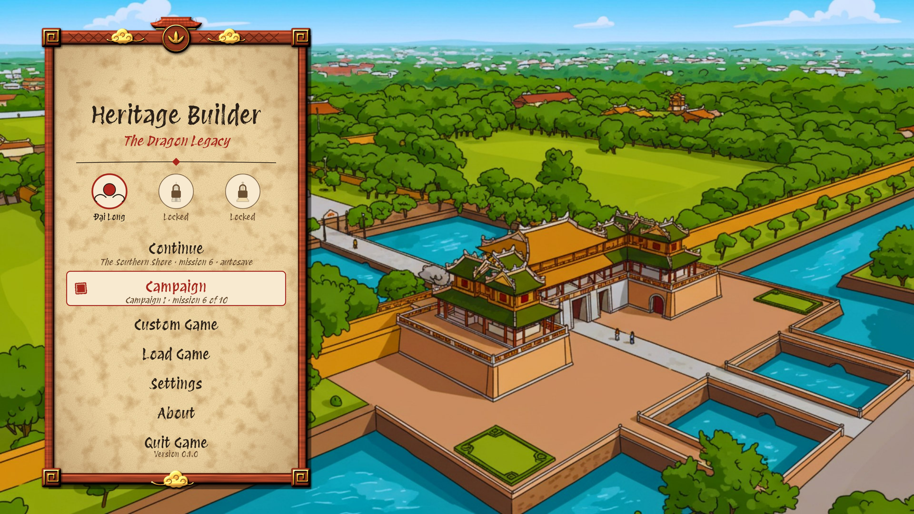

# Realm UI: menus, screens and HUD in each realm's style

**Status (2026-11-09): Phase 0 in progress; the `widgets.rs` split, the realm and player profile, localized strings and the sound hooks are done.** The user reviewed it on 2026-11-07: their notes are folded in (see [Review notes](#review-notes)), the open decisions' defaults are accepted, and every mockup the phases need now exists. This plan builds and restyles every retail screen after the [UI mockups](../design/mockups/README.md): the main menus, the world map, the intermission, the story comics, the HUD and the city management pages. Each screen gets one look per realm: Đại Long, Kambara and Tampadesa. It is milestone **UI** of the [roadmap](roadmap.md). It was researched against `ccca1df` on `claude`. File and line references point at that commit, so re-check them before relying on them.



## How to resume this work

- Work through the [phases](#phases) in order. Phase 0 builds what every later phase uses. Each later phase delivers one set of working screens, for all three realms, with its art, automation and tests.
- Tick the checkboxes as tasks land, and add a short dated note under the phase: the commit, the deviations, and what was verified. This file is the source of truth for progress.
- The [open decisions](#open-decisions) each have a default. Proceed with the default unless the user has decided otherwise, and record the answer here.
- The mockups are the visual reference. Their generator (`docs/design/mockups/generator/`) also draws the placeholder art (see [Art pipeline](#art-pipeline)), and `serve.py` shows changes to it live. Every screen in the phases has a mockup (see [Mockups](#mockups)).
- Follow [AGENTS.md](../../AGENTS.md) throughout:
  - Keep desktop and web compiling.
  - Only `engine/src/ui/immediate.rs` and the retained widgets call egui.
  - Every retail screen passes `ui.layout_issues`.
  - Run `cargo test --workspace` and the scenario scripts before pushing.
  - Regenerate `web/asset_manifest.json` after adding or removing assets.
- No save-format change is planned. The player's campaign progress goes in a profile file among the user configs, not in session saves (see [Realm and progress](#realm-and-progress)).
- New UI code leaves its sound hooks ready (see [Sounds](#sounds)), and its text goes through localized strings (see [Text](#text)).

## Goals

1. **Every retail screen in its realm's style**, as the mockups draw it: materials, frames, fonts, colours and motifs. The look follows the realm the player has reached (menus) or is playing (in game).
2. **Đại Long moves to the mockup style.** The prototype's sprites go: the parchment scrolls, page backgrounds, brush strokes, and the red menu-bar and palette buttons. Đại Long's home backdrop painting stays (see [open decisions](#open-decisions)).
3. **Skins as data.** One skin file per realm, merged over Đại Long's, names the sprites, fonts, colours and sizes. A new realm needs a skin file and an art run, not code. This follows the minimap's [style files](minimap.md#style-files).
4. **Placeholder art made by script**, from the same drawing code as the mockups, so the game and the mockups stay alike. It's never hand-placed, and hand-made art is never overwritten.
5. **The screens that don't exist yet are built now**, with the data the game has today:
   - the world map;
   - the intermission and its stele;
   - the briefing and the comic viewer;
   - the goals tracker, the rating badges and the message log;
   - the city management pages.

   Each grows as its milestone (M4, M9, M10, M11, M12) brings data, through a defined hook, not a rewrite.
6. **Testable.** Every screen opens with `dialog.open` or `ui.click`. It passes `ui.layout_issues` in all three skins and is covered by a scenario in CI.
7. **Works everywhere:** desktop and web, OpenGL and Wgpu, UI scales from 75% to 200%, and Vietnamese text in every skin.

**Not goals:**
- Final hand-drawn art. The pipeline swaps it in by file name when it exists.
- Translations. Every string moves into the localized string store, with English as its only language for now.
- Rebinding keys. The Controls tab exists and lists the bindings; editing them is Phase 5 of the game.
- Gameplay systems. Finance, ratings, trade, messages and story timing belong to their milestones. This plan builds their screens and the hooks those milestones fill.

## What exists today

From a survey of the code at `ccca1df`.

**Screens:**
- **Dialogs** (`crates/game/src/menu/dialog/`), all registered in `DialogMenuImpl` / `DialogMenuKind` (`dialog/mod.rs:66-119`):
  - Home, About, NewGame;
  - LoadGame, SaveGame and LoadOrSaveGame, all from one `SaveGameHelper` (`load_save.rs`);
  - MainSettings, with separate stacked Game, Sound and Graphics dialogs (the mockups have tabs);
  - MainGame, the in-game "pause" menu;
  - CityManagement, with Population, Resources and Finances (text only);
  - MissionComplete and CampaignComplete, which are placeholders: a title and buttons.
- **HUD** (`crates/game/src/menu/in_game/`):
  - `bars.rs`: TopBar with population, player icon, gold and date; LeftBar with Game, Load/Save, Settings and City buttons; SpeedControlsBar.
  - `palette.rs`: twelve 50-point sprite buttons, plus child menus of text buttons.
  - `inspector/`: four modal inspectors with the tile's sprite, a heading and text.
- **Toasts** (`engine/src/ui/toast.rs`): painter-drawn with hard-coded colours.
- **Not built:** no world map, briefing, intermission, comic viewer, goals tracker or message log.

**Art** (`assets/ui/`):
- **Stretched page sprites:**
  - `misc/scroll_bg.png` (every dialog);
  - `square_page_bg.png` (popups, inspector, minimap frame);
  - `tall_page_bg.png` (left bar, palette);
  - `wide_page_bg.png` (tooltips, top bar, speed bar, child menus).
- **Brush strokes:** `brush_stroke_divider.png` and its vertical twin.
- **Buttons:** `buttons/menu_bar/*` and `buttons/palette/*`, four states each.
- **Icons:** `icons/{population,gold,player,red_x}_icon.png`.
- **Home backdrop:** `misc/home_menu_static_bg.png`.
- **Unused:** `misc/home_menu_anim/` (30 frames, behind a `false` constant), `icons/app_icon_bg_large.png`, `icons/player_icon_no_bg.png` and `buttons/minimap/close_*`.

**Engine** (`crates/engine/src/ui/`):
- **Widgets:** 17 retained types, all in one file (`widgets.rs`, about 3,900 lines). Phase 0 split it into `widgets/`, one file per widget family.
- **Text:** `ui/text.rs` is a keyed string store loaded from `assets/configs/ui/text.json`, with two categories (TileDescription, UnitDialog) looked up by hashed key.
- **Sounds:** `ui/sound.rs` has seven `UiSoundKey`s, all placeholders (`buttons/default/*`, `misc/default/*`). Only text and sprite buttons play them (hovered and pressed); toggles, sliders, tabs, lists and dialogs play nothing.
- **Sprites:** every sprite is stretched over its rect (`uv_full`), with **no 9-slice**. Menu insets are clamped to 127 points.
- **Themes:** `UiTheme` is a fixed enum, `{Dev, InGame}` (`mod.rs:93`), with one style file each.
- **Style files** (`styles/game.json`): fonts, text styles, colours and egui widget visuals, but no sprites.
- **Plain egui widgets:** sliders, checkboxes, dropdowns and text inputs get their look only from the style file.
- **Sprite buttons** load `buttons/<name>_<state>.png` when built.

**Dialog framework** (`dialog/mod.rs`):
- Every dialog is built once per process (`initialize`, `:133`).
- A stacked dialog is drawn **inside the root dialog's window** (`draw_child_menu`, `:258`). It shares the root's size, background and insets, and its widgets take the root's path label (e.g. `Home/New Map Width`). That rules out per-dialog sizes and art.

**Realm:**
- The game has no current realm and no persistent campaign progress.
- `CampaignDef` has no realm (`campaign/config.rs`).
- Progress lives only inside session saves (`session.rs:707`, `:782`).
- So Continue and Custom Game are disabled TODOs, and Campaign always starts campaign 0 (`dialog/home.rs`).
- The minimap's `MinimapRealm` (`tile/minimap/style.rs:71`) is the only realm type.

**Automation that depends on today's names:**
- `ui_new_game.jsonl`: New Game, the map size inputs, Terrain Kind, Start New Game.
- `ui_build.jsonl`: the palette tooltips "Services" and "Roads", and the tile buttons.
- `ui_snapshot.jsonl`: dialog kind names, `LeftBar/settings`, `TilePaletteMenu/services` and `BuildingInspector/Close`.
- The `dialog.*` commands, by `DialogMenuKind` name.

## Design

### Realm and progress

```rust
// game/src/realm.rs: replaces MinimapRealm
#[derive(Copy, Clone, PartialEq, Eq, Debug, Display, EnumIter, EnumString, Serialize, Deserialize)]
#[strum(serialize_all = "lowercase")]
pub enum Realm { DaiLong, Kambara, Tampadesa }

// game/src/profile.rs: the player's progress across sessions
#[derive(Serialize, Deserialize, Default)]
pub struct Profile {
    pub version: u32,
    pub campaigns: Vec<CampaignProgress>,   // By campaign id: reached, missions finished, distinctions earned.
    pub last_save: Option<String>,          // What Continue loads.
    pub custom_realms: Vec<Realm>,          // Unlocked when their campaign is started (gdd.md 4).
}
```

- **Campaigns name their realm:** a `realm` field on `CampaignDef` in `campaigns.json`.
- **The profile file:**
  - It's `saves/user/profile.json`, beside the user configs (`saves/user/configs.json`). It's read and written with the user-file functions in `engine::save::storage` (`read_user_file`, `write_user_file`, `delete_user_file`), so on the web it lands in localStorage under `heritage_builder/saves/user/profile.json`, and `saves/user/` isn't listed as saves.
  - Unlike the configs, it isn't an overlay on defaults: the whole profile is written each time.
  - `--default-configs` leaves the user configs out but still reads the profile; a new `--fresh-profile` option starts from an empty one without touching the file, for scenarios and tests.
  - It's updated when a mission starts or ends, and on every save (`last_save`).
  - It isn't part of `GameSession`, so there's no save-version bump.
  - A missing or broken file means a fresh profile, with a logged warning.
- **`realm::ui_realm()`** decides which skin shows:
  - in game: the active campaign's realm, else the Custom Game's realm, else Đại Long;
  - in the menus: the latest realm the profile has reached;
  - an override from `ui.realm realm=...` (automation and the developer editor), so every skin can be tested without playing.
- **The minimap's style follows `ui_realm()`.** `MinimapRealm` and its reload command fold into this; `minimap.reload_style` stays as an alias.
- **Tests:**
  - a profile round-trips;
  - reaching campaign II switches the home realm;
  - a broken profile file falls back cleanly.

### Skins

A skin is everything realm-specific about the UI: one JSON file per realm, `assets/configs/ui/skins/<realm>.json`. Like the minimap styles, a realm's file holds only what it changes and is merged over `dailong.json` (move `merge_json` from `tile/minimap/style.rs` to a shared config helper).

```json
{
  "style": { "fonts": {...}, "text_styles": {...}, "colors": {...}, "widgets": {...}, "spacing": {...} },
  "text": { "title": "#2b2118", "accent": "#a8261c", "ink": "#2b2118", "sub": "#6b4f33", "on_accent": "#fff4dc", "disabled": "#8a7d68" },
  "panels": {
    "dialog":   { "sprite": "skins/dailong/panel_scroll.png", "slice": [96, 120, 96, 120], "content": [64, 84, 64, 84] },
    "popup":    { "sprite": "skins/dailong/panel_paper.png",  "slice": [40, 40, 40, 40],  "content": [28, 28, 28, 28] },
    "bar":      { ... }, "side": { ... }, "tooltip": { ... }, "card": { ... }, "well": { ... },
    "row": { ... }, "row_selected": { ... }, "field": { ... }, "caption": { ... }, "bubble": { ... }
  },
  "buttons": {
    "primary":   { "sprite": "skins/dailong/button_primary", "slice": [16, 16, 16, 16], "text": "on_accent" },
    "secondary": { ... }, "tab": { ... }, "tab_selected": { ... }, "menu_item": { "marker": "skins/dailong/marker_seal.png" },
    "icon": { "folder": "skins/dailong/icons", "size": 28 }
  },
  "controls": { "toggle": {...}, "checkbox": {...}, "slider": {...}, "dropdown": {...}, "scrollbar": {...} },
  "separators": { "rule": {...}, "ornament": {...} },
  "emblems": { "dailong": "skins/emblems/dailong.png", "locked": "skins/dailong/emblem_locked.png" },
  "backdrops": { "home": "misc/home_menu_static_bg.png", "dim": "#00000033" },
  "dialogs": { "Home": { "panel": "dialog", "size": [380, 980], "align": "left" }, "Settings": { "panel": "dialog", "size": [900, 640] } },
  "sounds": { "button_pressed": "buttons/dailong/pressed.wav", "dialog_opened": "misc/dailong/scroll_open.wav", "alert": null }
}
```

- **`style`:** today's `UiStyleDef` (fonts, text styles, colours, egui widget visuals, spacing), moved into the skin unchanged. `styles/game.json` becomes Đại Long's skin's `style` block. `dev.json` stays as it is.
- **`panels`:** the 9-slice backgrounds. `slice` is the sprite's border in pixels, left, top, right, bottom; those parts never stretch. `content` is the inset of the content in points. An optional `center: "tile"` repeats the centre instead of stretching it, for paper or stone grain.
- **`buttons`:** framed text buttons per role, each with four state sprites (the existing `_idle/_hovered/_pressed/_disabled` convention), plus the icon folder for sprite buttons.
- **`controls`:** sprites or colours for the toggle, checkbox, slider, dropdown and scrollbar, so they look like the mockups instead of egui's defaults.
- **`dialogs`:** each dialog's panel, size and placement, so a skin can lay out a screen differently without code.
- **Every sprite path in the UI code comes from the skin.** A unit test checks that `crates/game/src/menu/` has no `misc/` or `buttons/` string literals left.

**Engine changes:**
- **Data-driven themes:** `UiTheme` becomes a `UiThemeId` handle.
  - `UiSystem::load_styles` takes a list of named style definitions: `dev`, plus one per realm skin.
  - `set_ui_theme(id)` switches the theme, as today.
  - Fonts are already registered per style name (`style.rs:53-98`), so a realm's fonts sit beside the others.
- **9-slice:** `UiNineSlice { texture, slice_px: [f32; 4], scale, center: Stretch | Tile }` as 9 quads in one egui mesh.
  - Used by `UiMenu::with_panel`, `UiTooltipText::with_panel`, `UiTextButton::with_frame`, item list rows and tabs.
  - Also usable directly: `UiPainter::nine_slice(rect, &slice, tint)`.
  - Menu content insets stop going through egui's `i8` margin. The menu lays its contents out in its own inner rect, so the 127-point clamp goes away.
- **A skin version counter:**
  - Dialogs are built once per process today. `dialog::rebuild_all()` rebuilds them when the skin changes: a realm switch, entering a session, or `ui.reload_skin`.
  - The HUD menus are already rebuilt per session; they listen for the same counter.

**Game side:** `menu/skin.rs` holds the loaded `UiSkin`, with its textures loaded once per skin. It provides the helpers every screen builds with:
- `skin::dialog(kind)` and `skin::button(role, label)`;
- `skin::panel(name)` and `skin::tooltip(text)`;
- `skin::heading(text, level)` and `skin::separator(kind)`.

Today's `make_tooltip`, `make_text_button`, `make_dialog_popup` and the dialog defaults become these helpers.

### Widgets to add

First, `engine/src/ui/widgets.rs` (about 3,900 lines) becomes a folder, `engine/src/ui/widgets/`, with no change in behaviour:
- `mod.rs`: the `UiWidget` trait, `UiWidgetImpl`, the widget context and the shared helpers, re-exporting every widget so `ui::widgets::*` paths stay as they are;
- `menu.rs`: `UiMenu` and its flags, positions and insets;
- `text.rs`: text, headings and sized labels;
- `group.rs`: plain and labeled widget groups;
- `button.rs`: text and sprite buttons;
- `list.rs`, `input.rs` (sliders, checkboxes, dropdowns, text and number inputs), `tooltip.rs` and so on for the rest, one family per file;
- the new widgets below, each in its family's file or a file of its own.

The split goes in on its own, before any new widget, so its diff only moves code.

All retained widgets live in that folder. Each records itself for `ui.tree` and supports `ui.set` where it takes a value.

| Widget | For | Notes |
|---|---|---|
| `UiTabBar` | Settings, city pages, custom game options | Kind `tab`; tabs get the selected label in their paths, as the developer UI's `ui::tab_bar` does. |
| `UiToggle` | Settings | A pill switch, as in the mockups, with its on and off text. Sprites from `controls.toggle`, or painted from skin colours. |
| Framed `UiTextButton` | Every dialog's buttons | `with_frame(skin button)`, fixed or content width, primary and secondary roles. |
| `UiMenuItem` | Home's menu | A label with a subline under it ("Campaign I · mission 6 of 10"), a hover fill and the realm marker (seal, lotus, umbrella). |
| `UiListRow` template for `UiItemList` | Load/save, custom game maps, realms | Icon or emblem, title, subtitle, right-hand title and subtitle, and the selected-row panel. |
| `UiImage` | Save thumbnails, map previews, emblems, briefing art, comic panels | A texture in a rect, with an optional frame panel and fit (contain, cover, stretch). |
| `UiKeyValues` | Previews, intermission stats, city pages | Label and value pairs in two columns, values right-aligned. |
| `UiTable` | Goals (target and achieved), finance accounts | Header row, columns with alignment, an optional status icon column. |
| `UiMeter` | Goals tracker, ratings, relations | A bar, a ring (the rating badges), or a stepped meter (relations 0–5). Painted. |
| `UiColumns` | Two-column dialogs | Fixed or fractional column widths, each column a widget group. |
| `UiStepSelector` | Difficulty | Five steps, or any list. A dropdown would do, but the mockup shows steps. |
| `UiRichText` | Captions, briefing, stele lines | Wrapped text with inline emphasis and a per-span colour, e.g. a highlighted newest stele line. |

Toasts move onto the skin's `caption` panel and text colours.

### Dialog framework

- **Each dialog is its own window**, with its own panel, size and placement from the skin's `dialogs` block. This replaces drawing a stacked dialog inside the root.
  - The stack and Escape handling stay as they are.
  - A dialog flag says whether the dialog under it stays visible. Home's panel is hidden under Settings in the mockups.
- **Widget paths take the dialog's own label** (e.g. `Settings/Game/Autosave`). The scenarios and AGENTS.md's path notes are updated in the phase that changes them.
- **Dialog sizes are in points at 1920 × 1080** and scale down to fit smaller windows (minimum 1280 × 720), and with the UI scale setting.
- **Full-screen screens are dialogs with a `Fullscreen` panel:** the world map, the intermission and the comic viewer. They pause the simulation as dialogs do today.

### Fonts

The realm fonts are those of the mockups (`generator/common.py`, `REALM_FONTS`):

| Realm | Font | Vietnamese fallback |
|---|---|---|
| Đại Long | Protest Revolution | Covers Vietnamese itself |
| Kambara | Jaini | Spectral SC |
| Tampadesa | Amita (regular and bold) | Alegreya |

- **Fallback fonts:** add Spectral SC and Alegreya to `assets/fonts/` with their OFL files, as Jaini and Amita were added.
- **Glyph-by-glyph fallback:** egui text styles already take a fallback list (`text_styles.*.fallbacks`), so a Kambara heading shows "Đại Long" with Spectral SC's accented letters.
- **Body text** uses the realm font too, as in the mockups. A skin can give its body style a plainer face if small text reads poorly (see [open decisions](#open-decisions)).
- **Test:** a unit test lays out "Đại Long · Thái Ninh · Hội Thủy" in every skin's text styles and checks that no glyph falls back to the replacement character.

### Art pipeline

**`crates/tools/ui-art/`** draws every skin sprite and backdrop from the mockup generator's own drawing code.

**How it renders:**
- It imports the theme classes in `docs/design/mockups/generator/` (`world_map.py`, `screens.py`, `menus.py`). Those already draw each realm's materials as SVG: Đại Long's scrolls, parchment, wood and lacquer; Kambara's sandstone, moss and vines; Tampadesa's brick, teak, lacquer and gilt.
- It wraps each sprite in a page of its own size and shoots it with Playwright's Chromium, on a transparent background (`omitBackground`) at 2×. The browser is pre-installed in cloud sessions; locally, `npm i playwright` is enough.
- Small glyph icons stay with `crates/tools/ui-icons/` (Pillow, no browser). Its `icons.json` grows the HUD and build-bar glyphs from the mockups' `icon()` (`screens.py:302`).

**What drives it:**
- A **catalog**, `crates/tools/ui-art/art.json`. Each sprite entry gives:
  - realm, id and output path;
  - the generator call and its parameters;
  - size, slice borders and states.
- **`make_ui_art.py [--realm R] [ID...]`** renders what changed. It records each sprite's hash in `manifest.json` and never overwrites a file the manifest doesn't list, i.e. hand-made art.
- **`--check`** compares the catalog's slice borders and paths with the skin files, with no rendering. It runs in CI beside the tile generator's check.

**Output:**
- **Location:** `assets/ui/skins/<realm>/`.
- **Format:** PNG for sprites with alpha; JPEG for backdrops and comic placeholders.
- **9-slice sprites are small:** a dialog panel is about 512 × 512 at 2× however big the dialog. A realm's skin should come to 2–4 MB, plus about 0.5 MB per backdrop.

**What it makes per realm:**
- **Panels:** dialog, popup, bar, side, tooltip, card, well, row, selected row, field, caption, bubble.
- **Buttons:** primary, secondary, tab and selected tab, each in four states; menu item markers; icon button frames.
- **Controls:** toggle, checkbox, slider rail and knob, dropdown arrow, scrollbar.
- **Separators** and ornaments.
- **Emblems:** the three realm emblems, plus locked and current states.
- **HUD and page icons:** population, treasury, food, ratings, goals, message types, build categories, speed controls, the left-bar actions.
- **Home backdrops:** for Kambara and Tampadesa, from `menus.py`'s `home_scene`. Đại Long keeps its painting.
- **The world map base,** without markers (`world_map.py`'s map layers).
- **The stele**, without text (`screens.py`'s `stele`).
- **Comic placeholder panels:** the realm frame, an intro scene from `screens.py`'s `intro_scene`, and the panel's description as a dim caption. They're placeholders until real art exists.

**Old art:**
- Each phase deletes the old sprites its screens no longer use, with the web manifest regenerated.
- Phase 5 removes the last of them:
  - `misc/*_bg.png`;
  - the brush strokes;
  - `buttons/menu_bar/*` and `buttons/palette/*`;
  - the old icons.
- The unused files listed under [What exists today](#what-exists-today) go in Phase 0.

### Text

- **Every string moves to localized strings** as each screen is rebuilt, through `engine::ui::text`. No new retail UI code holds a literal the player reads.
- **The store grows into a localization layer:**
  - one file per language, `assets/configs/ui/text/<language>.json` (today's `text.json` becomes `en.json`), with the language from the Game settings tab (English only for now);
  - new categories: Menu, Hud, City, Story, Realm, Messages;
  - **arguments:** `{name}` placeholders filled at lookup (`text::format(category, key, &[("count", "3")])`), since most labels carry numbers, names or dates;
  - **plural forms:** a key may hold `one` and `other` forms, picked by a count argument;
  - a `UiText` value for widgets, either a key or literal text, so widget labels can take a key and look it up when drawn and again when the language changes;
  - **a fallback:** a key missing in a language falls back to English and is logged once; a key missing in English shows the key itself, so it's caught on screen;
  - a test that every key the code names exists in `en.json`, and that no language file has a key `en.json` lacks.
- **Tile and unit names** move into the store too, with their descriptions.
- **Realm-specific wording comes from data:**
  - era names;
  - season names;
  - the Legitimacy rating's name (Mandate, Divine Favour, Merit);
  - campaign subtitles.
- **No real-world names** appear anywhere (world.md, "Rules for the fiction").

### Sounds

The UI sounds are placeholders today (see [What exists today](#what-exists-today)) and will be redone with the art. New UI code gets the hooks now, so the sounds are a data change later:
- **Every interactive widget plays a sound key** for its events: hovered and pressed for buttons, menu items, tabs and list rows; toggled for toggles and checkboxes; changed for sliders and step selectors (rate-limited by the existing cooldown); opened and closed for dropdowns.
- **Dialogs** play an open and a close sound, and popups their own.
- **Keys are named by role**, not by file: `UiSoundKey` grows `TabSelected`, `Toggled`, `SliderChanged`, `ItemSelected`, `DialogOpened`, `DialogClosed`, `PopupOpened`, `Notification`, `Alert`, and so on. Each widget takes an optional override, as sprite buttons' `UiButtonSoundsEnabled` does today.
- **The skin maps roles to files** (its `sounds` block), so each realm can sound different. A role a skin doesn't name falls back to Đại Long's, and a role nobody names plays nothing. Until real sounds exist, every role maps to today's placeholders.
- `tests/ui_skins.rs` checks that every sound file a skin names exists.

### Automation and tests

- **New commands:**
  - `ui.realm realm=...` switches the skin for testing;
  - `ui.reload_skin` reloads the skin files and rebuilds;
  - `profile.state`, `profile.set` and `profile.reset` read and edit the profile;
  - `text.language` and `text.missing` switch the language and list the keys a screen looked up and didn't find.
- **Kept, or renamed with their scenarios in the same commit:**
  - dialog kind names;
  - button labels;
  - sprite-button names;
  - menu labels: `TopBar`, `LeftBar`, `TilePaletteMenu`, `BuildingInspector`.
- **Scenarios:** each phase adds one in CI, `ui_<phase>.jsonl`. It visits every screen of the phase in all three skins, clicks its buttons, checks `ui.layout_issues` is 0, and takes screenshots for the CI artifact.
- **Goldens:** `ui_snapshot.jsonl` loops over the three skins, and its goldens are regenerated per backend locally.
- **`tests/ui_skins.rs`** checks that:
  - every skin loads;
  - every sprite it names exists;
  - the 9-slice borders fit their sprites;
  - the fonts cover the test strings.

## Review notes

The user's notes from the 2026-11-07 review, and where each landed:

| Note | Where |
|---|---|
| Break `ui/widgets.rs` up into a folder of smaller files | [Widgets to add](#widgets-to-add), Phase 0 |
| The profile goes in the user configs folder, `saves/user/` | [Realm and progress](#realm-and-progress), open decision 4 |
| Move all text to localized strings, growing `ui/text.rs` | [Text](#text), Phase 0 |
| Save thumbnails at the save's camera position, at a configurable size | Phase 1's save metadata, open decision 10 |
| Animated home backdrops later, as video rather than still frames | [Later](#later) |
| UI sounds are placeholders: new UI code leaves the hooks ready | [Sounds](#sounds), Phase 0 |
| Record the mockups already made | [Mockups](#mockups) |

## Phases

Phases 1 to 6 follow the order the user set. [Dependencies](#dependencies-on-other-milestones) lists what each screen needs from other milestones; every phase ships with today's data and leaves a hook for the rest.

### Phase 0: Foundations

**Delivers:**
- the skins, the art pipeline and the new widgets;
- a developer **Skin Gallery** window that shows every panel, button, control and widget in the chosen realm;
- popups, tooltips and toasts restyled.

The existing dialogs keep their layouts but take their panels from the Đại Long skin.

- [x] `Realm`, `Profile` (`saves/user/profile.json`, `--fresh-profile`), `realm::ui_realm()`, a `realm` field in `campaigns.json`; `profile.*` and `ui.realm` commands; tests.
- [ ] Engine: data-driven themes (`UiThemeId`), `UiNineSlice` and `UiPainter::nine_slice`, menus laying out in their own inner rect (no `i8` insets).
- [ ] Skins: `assets/configs/ui/skins/{dailong,kambara,tampadesa}.json`; `menu/skin.rs`; the skin version counter and `dialog::rebuild_all()`; `ui.reload_skin`. `styles/game.json` folds into Đại Long's skin. The skin's `sounds` block, applied with `ui::sound::set_mapping` on each skin switch; `assets/configs/ui/sounds.json` folds into Đại Long's skin.
- [ ] Fonts: add Spectral SC and Alegreya (and their OFL files); realm text styles with fallbacks; the Vietnamese glyph test.
- [x] Split `engine/src/ui/widgets.rs` into `engine/src/ui/widgets/`, one widget family per file, with no change in behaviour, in a commit of its own.
- [x] Localized strings: `text/<language>.json`, the new categories, arguments, plural forms, `UiText`, the fallback and its test; `text.*` commands. Move today's strings for the screens Phase 0 touches.
- [x] Sound hooks: the role keys, per-widget sound events and overrides, a placeholder role-to-file mapping in `assets/configs/ui/sounds.json` with `ui::sound::set_mapping` for the skins (the skin's `sounds` block: see Skins), dialog and popup open and close sounds.
- [ ] Widgets: `UiTabBar`, `UiToggle`, framed `UiTextButton`, `UiMenuItem`, `UiListRow`, `UiImage`, `UiKeyValues`, `UiTable`, `UiMeter`, `UiColumns`, `UiStepSelector`, `UiRichText`, each in the developer sample menus (`engine/src/ui/tests.rs`). Each interactive one plays its roles through a `UiWidgetSounds` (`sounds.play(context, event, Some(role))`): `UiTabBar` `tab_selected`, `UiToggle` `toggled`, `UiMenuItem` and `UiListRow` `item_hovered` and `item_selected`, `UiStepSelector` `slider_changed`.
- [ ] Dialog framework: each dialog its own window, from the skin's `dialogs` block; the "keep the dialog under it visible" flag; paths take the dialog's own label (update `ui_new_game.jsonl`, `ui_snapshot.jsonl`, AGENTS.md).
- [ ] `crates/tools/ui-art/`: the catalog, `make_ui_art.py` (render, manifest, `--check`), the first sprites for all three realms (panels, buttons, controls, separators, emblems); `--check` in CI.
- [ ] Popups (Quit, Overwrite), tooltips and toasts on skin panels.
- [ ] Remove the unused old files (see [What exists today](#what-exists-today)).
- [ ] `tests/ui_skins.rs`; a `ui_skins.jsonl` scenario that opens the Skin Gallery in each realm and checks `ui.layout_issues`.

**Notes (2026-11-09):**
- The widgets split (commit `260dd32`): `engine/src/ui/widgets/mod.rs` keeps the context trait, `UiWidget`, `UiWidgetImpl`, the casts, callback types and shared helpers, and re-exports every family file (`pub use button::*;` and so on), so every `ui::widgets::<Name>` path is unchanged and nothing outside `engine/src/ui/` changed. The family files are `menu.rs`, `message_box.rs`, `text.rs`, `group.rs`, `button.rs`, `tooltip.rs`, `separator.rs`, `image.rs` (`UiSpriteIcon` and `UiSlideshow`), `input.rs` (sliders, checkboxes, number and text inputs, dropdowns) and `list.rs`. Each file keeps the old section banners.
- The only edits that aren't moves are the ones the split forces: `pub(super)` on `UiMenu`'s `background` and `content_insets`, `UiMessageBox`'s `menu`, and `UiTooltipText`'s `text` and `draw`, which other family files use; and `crate::ui::` in place of `super::` for `screen_size` (twice), `custom_tooltip` and `text`. Comments naming `widgets.rs` in `ui/mod.rs`, `immediate.rs`, `internal.rs`, `registry.rs` and AGENTS.md now name the folder.
- `widget_id` hashes the widget's type name, which now includes its file's module (`widgets::menu::UiMenu`; only `UiMenu`, `UiTextInput`, `UiDropdown` and `UiItemList` use it). That changes no behaviour: the id only has to stay the same from frame to frame and tell widgets apart, it also hashes the widget's address, and egui's memory isn't saved (no `persistence` feature).
- Verified: `cargo build -p HeritageBuilder`, `cargo test --workspace` and the web target check; `ui_build`, `ui_new_game`, `ui_dev_menus`, `minimap` and `ui_snapshot` (the `ui.tree` listing of every screen, without rects) print the same results as before the split, apart from the minimap's bake time. A sorted-lines diff of the old file against the new files, and an in-order diff with the files put back in the old order, show only the edits above.

**Notes (2026-11-09, realm and profile; commit `a94f4e1`):**
- `game/src/realm.rs`: `Realm` (lowercase in strum and serde) replaces `MinimapRealm`. `choose_ui_realm(&UiRealmInputs)` is the pure decision behind `ui_realm()`: the `ui.realm` override, else in game the active campaign's realm (Custom Game's is a `TODO(realm-ui)`), else in the home menu the latest campaign the profile reached, else Đại Long. The minimap's style follows it.
- `game/src/profile.rs`: `Profile` and `CampaignRecord` (named so to avoid `campaign::CampaignProgress`), strict serde with a version check; the user file `profile` is written whole after each change. A missing, broken or other-version file gives a fresh profile with a warning and is left alone. `distinctions` waits for M9.
- Never written by `--fresh-profile` (never read either), script mode, replays, `--smoke-test-saves` or the test harness. CI passes `--fresh-profile` to every scenario, determinism and replay run.
- `CampaignDef` has `id` and `realm`; hooks: a mission start reaches its campaign, a finished mission is queued by `campaign::tick` and recorded by `GameLoop`, a campaign's last mission reaches the next one, a successful save sets `last_save`.
- Commands: `ui.realm`, `profile.state`, `profile.set`, `profile.reset`.
- Deviations: a recording's header holds the profile and its replay uses it (an explicit `--fresh-profile` wins, with a warning). The minimap keeps each style file's JSON from its first read, so realm switches work on web, which reads an asset only once. `minimap.reload_style realm=` is now an alias that sets the override, and puts it back if the reload fails.
- Tests: `tests/realm_profile.rs`, the finished-missions queue in `tests/campaign.rs`, and `ui.realm` checks in `minimap.jsonl`.
- Verified: build, `cargo test --workspace` and the web target check; the CI scenarios with `--fresh-profile`; determinism twice with the same checksum; record and replay of `ui_build` and `determinism`; a live game writing, reloading, rejecting broken and other-version files, and resetting the profile; no `saves/user/profile.json` after scripts, replays, the smoke test or tests. Not run: the mission-finished path end to end in a live game (it needs goals met), and the web build in a browser.

**Notes (2026-11-09, localized strings; commit `b8fc255`):**
- `engine::ui::text`: `text/<language>.json` keyed by category name (`text.json` became `en.json`, without its order rule and panic), with the new categories; `get`, `format`, `format_count` (CLDR plural forms, a per-language `PluralRule`), `find_str` as before. Every file loads at init and stays; `set_language` switches by name, from `GameConfigs::engine.language` (its dropdown: a Phase 1 `TODO(realm-ui)`); a replay applies its recording's.
- Retained widgets' label and tooltip setters take `impl Into<UiString>`; call sites are unchanged. Dropdown and item-list items (`UiDropdown::new`, `reset_items`, `UiItemList::reset_items`) are still plain strings. Menu and popup labels stay strings (automation ids), but a menu without a background sprite draws its label as its title, which needs a `UiString` once localized.
- Moved: the Quit and Overwrite popups; the construction, screenshot and debt toasts.
- Commands `text.language`, `text.missing`, `text.get`; `strings.jsonl`, in CI. The key check (`cargo test -p engine --lib text`) scans every crate for `UiTextCategory::<Name>, "<key>"`.
- Deviations: `UiString`, not `UiText` (a widget's name). The store is a static that loads on first use. The web file system lists its preloaded assets. `config.set /engine/language` doesn't switch the live language; `text.language` does.
- Limit: text a menu copies or measures when built (the inspector's descriptions, the bars' and palette's sizes) follows a switch only once rebuilt; nothing rebuilds on `text::version()` yet.
- Verified: build, `cargo test --workspace`, web check; the key check fails on a missing key, a duplicate key, and a second file's extra key or placeholder. CI scenarios and `strings.jsonl` pass; `ui_snapshot`'s listings match; `ui_build` and `determinism` replay. A temporary second language switched live, fallbacks logged once. A broken or missing `en.json` logs errors and shows keys. Web in headless Chrome loads the text.
- Still literal: the other screens (Home, About, New Game, the Game menu, Load/Save, Settings, City Management, Mission and Campaign Complete), the HUD, inspector and minimap text, and names from data (tiles, units, goods, tax levels, ledger categories, seasons, eras).

**Notes (2026-11-09, sound hooks; commit `5a7b177`):**
- `engine::ui::sound`: `UiSoundKey` has 20 roles (snake_case in data); per-role flags and cooldowns; `UiSoundEvent` and `UiWidgetSounds` (per event: the widget's default role, another, or silence) replace `UiButtonSoundsEnabled`. Buttons, checkboxes, sliders, number fields' steps, dropdowns and item lists play their roles; `UiMenu` plays open and close roles it's given; dialogs (all but Home) and `UiMessageBox` popups get theirs. Text inputs and the developer UI are silent.
- Mapping: `assets/configs/ui/sounds.json`, read once at init; `set_mapping` lays overrides over it, for the skins step.
- Game: `construction_completed` once per frame, `alert` for debt warnings and new minimap alerts, `notification` for the out-of-debt and screenshot toasts; `TODO(realm-ui)` for M11's messages.
- `ui.sounds` lists the roles played (a ring of 64), with or without an audio device; `ui_sounds.jsonl` in CI; `cargo test -p engine --lib sound` checks the mapping.
- Deviations: the default mapping is a config file until skins exist. Cooldowns run on frame time, not wall-clock time, so scripts are repeatable. Debt warnings play `alert`, not `notification`. A dropdown's pick plays `item_selected` instead of `dropdown_closed`. Two roles mapped to one file starting in the same frame play it once, so a press and the dialog it opens still click once. Escape's simulated button press became `dialog_closed`.
- Seen, not changed: Escape in a two-deep stack closes both dialogs (the dialog framework step's Escape owner); the shared per-role cooldown drops a second press within 0.2 s, as before.
- Verified: build, `cargo test --workspace`, web check; CI scenarios and `ui_sounds` (twice, same output); `ui_build` record and replay. Not run: real audio (no device here), web in a browser.

### Phase 1: Main menus

**Delivers:** the home menu and every dialog under it, as in the mockups (`menu-*-<realm>.jpg`), in all three realms. The in-game Game menu and its popups get the same look.

**Home:**
- [ ] Tall panel on the left with the crest, title and campaign subtitle.
- [ ] The **campaign row** of three emblems: reached, current, or "Locked", from the profile.
- [ ] **Menu items:**
  - **Continue** loads `profile.last_save`, with the subline "<mission> · <campaign> · autosave";
  - **Campaign** starts or resumes the reached campaign at its next mission (a campaign picker when more than one is reached: `campaign-picker-<realm>.jpg`);
  - **Custom Game**, Load Game, Settings, About, Quit Game.
- [ ] The realm marker on the hovered item, and the version string.
- [ ] **Backdrop:** Đại Long's painting; Kambara's and Tampadesa's generated scenes. The skin decides.
- [ ] `HomeButtonKind` loses New Game, whose options move into Custom Game (see [open decisions](#open-decisions)).

**Load / Save** (one dialog, `LoadOrSaveGame`):
- [ ] **Save rows:** realm emblem, name, "Campaign I · mission 6 · <city>", the save time, and the in-game date in the realm's era.
- [ ] **Preview:** thumbnail; Mission, Campaign, Date, Population, Treasury, Time played.
- [ ] **Save as** field, and Delete (new, with a confirm popup), Cancel, Save and Load.
- [ ] **Save metadata:**
  - The save writes a small header, beside the version the loader already probes for, plus a thumbnail (`saves/<name>.jpg`).
  - The thumbnail is a screenshot of the city at the camera position the save was taken from, with the UI left out (`Engine::request_screenshot`), scaled down.
  - Its size is a config, `SaveConfigs::thumbnail_size` (default 320 × 180), so it can be raised if it looks blurry in the preview, which shows it larger than that. The preview fits whatever size the file has.
  - Both are read without loading the session.
  - Old saves without them show a blank thumbnail and "—".
  - This is the only save-adjacent change. The header is new top-level fields read before the session, and needs a migration script only if the loader requires them. The default is optional fields with a fallback, as the version probe allows.

**Settings** (`MainSettings` with tabs; the Game, Sound and Graphics dialogs become tabs):
- [ ] **Game:**
  - autosave toggle and interval;
  - default game speed;
  - edge scrolling;
  - the three camera zoom toggles;
  - UI scale (75–200%);
  - colour-blind-safe overlays (a stored flag; the overlays follow in M6 and M7);
  - language (English only for now).
- [ ] **Sound:** master, music, SFX, ambience, narration and spatial volume; mute in the background.
- [ ] **Graphics:** window mode, resolution, renderer, VSync, frame rate limit, texture filtering, mipmaps, animated water. Settings the engine can't change live say "after a restart".
- [ ] **Controls:** the key bindings, read-only.
- [ ] Restore defaults, Cancel, Ok, through the existing `SettingsCategory` commit path.

**Custom Game:**
- [ ] **Realm rows**, locked until their campaign is started ("Start Campaign N to unlock").
- [ ] **Map rows** (a new `assets/configs/game/maps.json`: the preset maps, the sample saves' maps, and a **Blank map** entry with width, height and terrain, which replaces New Game).
- [ ] **Preview:** the minimap bake of the map, and its stats.
- [ ] **Options:**
  - starting date, from the realm's eras;
  - goals (Sandbox, or a goal set);
  - starting treasury;
  - difficulty in 5 steps (stored; applied by M4 and M9);
  - toggles: seasons and floods, fires and collapses, raids, and fast construction. Fast construction is `construction.time_scale`, which closes the construction plan's open item. The others are stored and disabled with "coming in M6/M7/…" tooltips until their systems exist.
- [ ] Cancel and Start. A custom game sets the realm the in-game skin uses.

**About:**
- [ ] Crest, title, the studio line, the credit sections, "Built with", the quote, version and copyright, Back.

**In-game Game menu (MainGame):**
- [ ] Resume, Save, Load, Settings, Quit to menu, Exit, in the dialog style.
- [ ] Quit's confirm popup.

**Wrap-up:**
- [ ] Art: home backdrops for Kambara and Tampadesa; the save-row emblems; the remaining menu sprites.
- [ ] Delete `misc/scroll_bg.png` once nothing uses it.
- [ ] Scenarios:
  - `ui_menus.jsonl` (every dialog, every realm, Continue, Custom Game start, settings commit);
  - update `ui_new_game.jsonl` to the Blank map path.

### Phase 2: World map

**Delivers:** the world map screen (`world-map-<realm>.jpg`), opened from the minimap's World map tool (enabled at last), from the intermission, and from the HUD. Trade and diplomacy show their data read-only until M10 makes them act.

- [ ] **Data:** a `world_map` block per campaign in `campaigns.json`, or its own file (`assets/configs/game/world/<campaign>.json`). It holds:
  - **cities:** id, name, position, kind (capital, city, monument), owner realm or power, role;
  - **routes:** kind (river, sea, land), points, state;
  - **region labels**, uncharted areas and threats.
  - Player cities come from the profile's finished missions: each mission names the city it founds.
- [ ] **Base art:** the map without markers, rendered per campaign by `ui-art` from `world_map.py`'s layers (sea, land, rivers, relief, frame) at 2×.
- [ ] **Markers and labels** drawn live over it, so a city joining the map needs no new art:
  - cities and their seals or lotus or stupa marks, in the realm font;
  - routes by kind and state;
  - the next mission's A/B choice sites;
  - the compass.
- [ ] **Top bar:** title, realm subtitle, date and season, treasury, "Return to the city".
- [ ] **Side panel for the selected city:**
  - emblem, name, role;
  - relations meter;
  - route line;
  - "They sell" and "They buy" with prices;
  - the court's request box;
  - "Set trade limits" and "Send a gift" (disabled, "coming with trade" until M10).
- [ ] **Legend bar.**
- [ ] **Next mission choice:** the choice box with both sites. Picking one starts that mission's map. Only missions with `choices` in their config show it. Campaign I's missions 6–8 get them in Phase 2 of the game; until then a test mission in config exercises it.
- [ ] **Hooks for M10:** `WorldMapProvider` gives trade data (prices, limits, requests, relations) when trade exists. Until then the panel reads the config's static values.
- [ ] Scenario `ui_world_map.jsonl`: open it in each realm, select a city, pick a choice site in the test campaign, return.

### Phase 3: Intermission and briefing

**Delivers:**
- **The debrief** after a mission (`intermission-<realm>.jpg`), replacing MissionComplete;
- **the finished stele** at the end of a campaign, replacing CampaignComplete;
- **the briefing** before a mission.

- [ ] **Stele, left:**
  - the stele art per realm (from `ui-art`), with text set live;
  - the campaign's stele title;
  - one carved line per finished mission (from mission config: `stele_line`, plus a line per distinction earned);
  - the newest line highlighted and freshly marked;
  - empty rows for the missions to come.
  - "Carved" text is the realm font drawn twice, with an offset shadow and highlight from skin colours.
- [ ] **Panel, right:**
  - "MISSION N COMPLETE", the name, the city and its era year;
  - goals table, target and achieved, from the mission's requirements;
  - distinctions: hidden until M9 brings them;
  - ratings: four meters, hidden until M9;
  - stats: population, treasury, years taken;
  - the "joins the world map" note;
  - "Keep playing" and "Continue to the world map". The second goes to Phase 2's screen, or to the next mission when no world map is configured.
- [ ] **Campaign complete:** the whole stele, a closing line, "Return to the menu". The profile marks the next campaign reached, which switches the home realm.
- [ ] **Briefing** (`briefing-<realm>.jpg`): a scroll or tablet with the mission's name, its stele lead-in, its text (`MissionDef.description`, which nothing shows today), its goals, and an image slot. "Begin". It opens when a mission's map loads and from a HUD button during the mission.
- [ ] **Flow:** `campaign::take_pending_prompt` opens the debrief. The `MissionComplete` and `CampaignComplete` kind names stay, so the snapshot scenario still finds them.
- [ ] Scenario `ui_intermission.jsonl`: finish a test mission (by meeting its goals with `world.*` and `time.fast_forward`), check the debrief's goals, continue, finish the campaign, and check that the profile reached the next one.

### Phase 4: Story comics

**Delivers:** the comic viewer (`intro-<realm>.jpg`), with sequences I-A (before mission 1) and I-B (after mission 5) of story-script.md as data with placeholder panels. Every other sequence is data only, later.

- [ ] **Data:** `assets/configs/story/<campaign>.json`. Sequences have an id, a title and a trigger ("before mission N", "after mission N", "epilogue"). Panels have:
  - an image;
  - a narration caption;
  - bubbles: speaker, text, kind (speech, whisper, group, bold), anchor and tail point;
  - an optional sepia flag for flashbacks.
- [ ] **Viewer:**
  - the full-screen panel in the realm frame;
  - the caption on the skin's `caption` panel;
  - bubbles painted (rounded panel and tail) or 9-sliced from the skin's `bubble`;
  - **bottom bar:** campaign line, sequence title, panel dots (done, current, to come), "Panel N of M", Skip, Next.
  - Keys: Space, Enter and Right go forward; Left goes back; Escape skips.
- [ ] **Triggers:** the campaign flow plays a sequence before a mission's briefing or after its debrief, as its trigger says. Each sequence plays once per profile, and Home gets "Replay the story" when one has been seen.
- [ ] **Dynamic panels:** a panel can list the player's stele lines (I-E, the epilogue).
- [ ] **Placeholder art:** `ui-art` makes each panel from the realm's scene drawing and frame, with the panel's description from the script as a dim caption. Real art replaces a file of the same name.
- [ ] Scenario `ui_story.jsonl`: start campaign I, step through I-A, check the panel count and that Skip lands on the briefing.

### Phase 5: HUD

**Delivers:** the in-game HUD as in `hud-<realm>.jpg`, with every old sprite gone.

- [ ] **Top-left bar:** speed controls (pause, play, fast, faster) and the date in the realm's era with the season under it. This replaces SpeedControlsBar and the TopBar's date.
- [ ] **Top-centre bar:**
  - population, treasury and food, each with its icon;
  - four rating badges (ring meters with the realm's Legitimacy initial), showing "—" until M9.
- [ ] **Game menu buttons:** Game, Load/Save, Settings, City and the briefing. The HUD mockup has no place for them; `hud-menus-<realm>.jpg` puts them in their own bar left of the build bar.
- [ ] **Goals tracker,** left: the mission name, each goal with its tick, text, progress and bar, live from the mission's requirements. Collapsible. It's hidden in custom games without goals.
- [ ] **Build bar,** right:
  - the mockup's column of category buttons in the realm style;
  - the hovered button's tooltip (title and subtitle);
  - child menus as skin lists with each building's icon, cost and materials, greyed out with the reason when unaffordable (the construction plan's tooltip);
  - clear, roads, undo and redo kept (see [open decisions](#open-decisions) on categories).
  - The `TilePaletteMenu/<sector>` paths and their tooltips stay, so `ui_build.jsonl` keeps working.
- [ ] **Message log,** bottom centre: the three latest messages with type icons, the newest bold with "now".
  - Until M11 it shows the notices the game already raises: construction completed, minimap alerts, saves.
  - It goes through a small `MessageLog` store that M11 replaces with its typed messages.
  - Toasts stay for screenshots and the like.
- [ ] **Inspector:** the building, unit, prop and terrain inspectors on the skin's side panel or card (`inspector-<realm>.jpg`). The `BuildingInspector/Close` paths stay.
- [ ] **Minimap:** its frame, tooltips and button folder come from the skin, so `assets/configs/ui/minimap/<realm>.json` keeps only the map's own settings.
- [ ] Delete the old sprites: `buttons/menu_bar/*`, `buttons/palette/*`, `icons/{population,gold,player}_icon.png`, `misc/{wide,tall,square}_page_bg.png`, the brush strokes.
- [ ] Scenarios:
  - `ui_build.jsonl` updated;
  - `ui_hud.jsonl`: speed controls, goals progress after placements, the message log after a building completes, all in three realms.

### Phase 6: City management pages

**Delivers:** the City book, one dialog with a tab or page per area, replacing CityManagement and its three text dialogs. Mockups: `city-<page>-<realm>.jpg` (see [Mockups](#mockups)).

- [ ] **Page framework:** the City dialog with side tabs (`UiTabBar`, vertical).
  - Each page is a `CityPage` impl: title, icon, build, refresh.
  - A page registers itself, so M4, M9 and M11 each add theirs without touching the others.
  - Pages refresh on open and once a game month.
- [ ] **Overview:** population, treasury, food months, employment, rating badges, warnings (no water, no food, unemployment).
- [ ] **Population:**
  - housing by level (counts, with the next level's needs);
  - workforce: employed, unemployed, by sector;
  - a monthly trend line.
  - A `CityHistory` ring buffer is sampled each game month. It's runtime only, rebuilt from zero after a load, until a milestone needs history in saves.
- [ ] **Goods:** storage yards and granaries by good, grouped (foods, consumer goods, raw materials) with icons, capacity bars and monthly change. This replaces the Resources dialog and fixes its overflow (goods.md).
- [ ] **Finances:** treasury, tax income, costs. M4 fills in the yearly accounts table (this year against last), wages and tax rates.
- [ ] **Heritage** (`city-heritage-<realm>.jpg`): faith and monuments (GDD 5.11 and 5.15), in three sub-tabs (`UiTabBar` inside the page; chosen over a single page on 2026-11-08 so each part has room to grow):
  - **Monument:** for missions that have one. The monument and its site, its stages (built, in progress, to come), the current stage's materials delivered and specialist workers against what it needs, the time left at the current rate, and its bonuses when finished. Missions without one show the tab disabled, with "No monument in this mission".
  - **Patrons:** the realm's 3–5 patrons, each with its domain, favour, mood, and the blessing or misfortune its favour is heading towards.
  - **Festivals:** the festival year on a month strip, the realm's festivals with their patron and status, and a planner for the selected one: venue, scale (modest, grand, royal), costs against stock, effects, and a Hold button. The mockup shows this tab.
  - The page and its tabs exist from Phase 6 with whatever data the game has; faith and festivals (M8) fill in Patrons and Festivals, and monuments (game Phase 2) fill in Monument (see [Dependencies](#dependencies-on-other-milestones)).
- [ ] **Hooks:** the pages M9 (Ratings, with what drives each), M11 (Labour, Food, advisors' notes) and later milestones (Trade, Military, the Court) add. Each milestone's plan gets a checkbox for its page.
- [ ] **Paths:** `CityManagement` stays as the dialog kind, with the page names as tabs. `PopulationManagement`, `ResourcesManagement` and `FinancesManagement` open the City dialog on their page, so `ui_snapshot.jsonl`'s `dialog.open` calls still work.
- [ ] Scenario `ui_city.jsonl`: open each page in each realm after building a small town; check the numbers against `world.stats`.

## Dependencies on other milestones

| Screen | Works now with | Filled in by |
|---|---|---|
| Home, Continue, Campaign | Profile (Phase 0) | Campaigns II and III configs (game Phases 3 and 4) |
| Custom Game options | Fast construction | Seasons and floods (M7), fires (M6), raids (game Phase 2), difficulty (M4, M9) |
| World map | Config cities, routes, choices | Trade, prices, limits, requests, relations (M10); sea routes and gifts (game Phase 2) |
| Intermission | Goals from requirements, stats | Distinctions and ratings (M9) |
| Briefing and comics | Mission text, I-A and I-B data | Story events, the other sequences (game Phase 2) |
| HUD ratings, goals | Requirements progress | Ratings (M9), new goal types (M9) |
| Message log | Existing notices | Typed messages, popups for important events (M11) |
| City pages | Population, goods, treasury | Accounts (M4), ratings (M9), labour and food advisors (M11) |
| Heritage page | The tabs, empty | Faith and festivals (M8): patrons, favour, blessings, festivals; monuments and guilds (game Phase 2) |

The roadmap's convention stands: new retail screens go through the skins and pass `ui.layout_issues`. From Phase 0 on, a milestone that adds a screen builds it with this plan's widgets and skin helpers.

## Mockups

Every screen the phases build has a mockup in all three realms, in [docs/design/mockups/](../design/mockups/README.md). The first set came with the plan's research: the world map, the intro comic, the intermission, the HUD and the main menus (`world-map`, `intro`, `intermission`, `hud`, `menu-{home,load-save,settings,custom-game,about}`). The screens it found missing were drawn on 2026-11-07 (commit `8a44c00`):

| Screen | Phase | Mockup |
|---|---|---|
| Campaign picker (more than one campaign reached) | 1 | `campaign-picker-<realm>.jpg` |
| In-game Game menu and the Quit popup | 1 | `game-menu-<realm>.jpg`, `game-quit-<realm>.jpg` |
| Briefing scroll | 3 | `briefing-<realm>.jpg` |
| Campaign complete (the finished stele) | 3 | `campaign-complete-<realm>.jpg` |
| HUD game-menu buttons, the build bar's child menu and its tooltip with costs | 5 | `hud-menus-<realm>.jpg` |
| Building inspector | 5 | `inspector-<realm>.jpg` |
| City book: Overview, Population, Goods, Finances | 6 | `city-{overview,population,goods,finances}-<realm>.jpg` |
| City book: Ratings, Labour, Food | 6, for M9 and M11 | `city-{ratings,labour,food}-<realm>.jpg` |
| City book: Heritage (monument, patrons, festivals; added 2026-11-08) | 6, for M8 and game Phase 2 | `city-heritage-<realm>.jpg` (Festivals tab) |
| Important-event popup (flood, fire, court request) | 5, for M11 | `event-<realm>.jpg` |

The HUD's menu buttons got their own bar left of the build bar, not the left end of the top-left bar (Phase 5's default): the date leaves no room there.

## Performance

- Skins load once per realm switch: tens of sprites, a few MB.
- **9-slice:** 9 quads per panel, the same draw path as today's stretched sprites.
- **World map:** one textured quad for the base, plus tens of painted markers.
- **Comics:** one panel image loaded at a time, the next prefetched.
- **City pages:** the history buffer is 120 samples per series, sampled monthly.

## Open decisions

The user accepted every default on 2026-11-07, with the changes marked below.

| # | Question | Default |
|---|---|---|
| 1 | Body text in the realm font, as the mockups have it, or a plainer face for small text? | Realm font. A skin can set a plainer body face if small text reads poorly in testing. |
| 2 | Đại Long's home backdrop | Keep the painting, as the mockup does. Only the UI sprites go. |
| 3 | New Game (map size and terrain) on Home | Remove it. A Blank map entry in Custom Game takes its options. |
| 4 | Where the profile lives | `saves/user/profile.json`, beside the user configs; localStorage on web. (Changed in review.) |
| 5 | 9-slice centres | Stretch. `center: "tile"` per panel where grain shows. |
| 6 | Dialogs: each its own window, or stacked inside the root as today | Each its own window. |
| 7 | Build bar categories: the mockup's nine (house, water, farm, industry, trade, temple, learning, defence, monument) or today's sectors | Today's sectors with the mockup's icons. New categories come only with buildings that need them. |
| 8 | Where the game menu buttons go in the HUD | Their own bar, left of the build bar (`hud-menus-<realm>.jpg`). |
| 9 | The art renderer | Playwright's Chromium on the generator's SVG; Pillow stays for glyph icons. |
| 10 | Save thumbnails | A JPEG beside each save, taken at the save's camera position; its size is a config (default 320 × 180). Old saves show none. (Changed in review.) |
| 11 | Ratings and distinctions before M9 | Hidden, not shown as placeholders. |

## Later

- Animated home backdrops per realm. Play a short looping video in a simple format (for example VP9 or AV1 in WebM, decoded to a texture) rather than a sequence of still frames, to keep the size down; the unused `misc/home_menu_anim/` frames show the idea. The web build can use the browser's own video decoder.
- Real UI sounds per realm, mapped to the role keys the skins already name.
- Hand-made art replacing the placeholders, file by file.
- Translations, into the language files the strings already live in.
- Key rebinding on the Controls tab.
- An encyclopedia (overview.md's content budget mentions entries).
